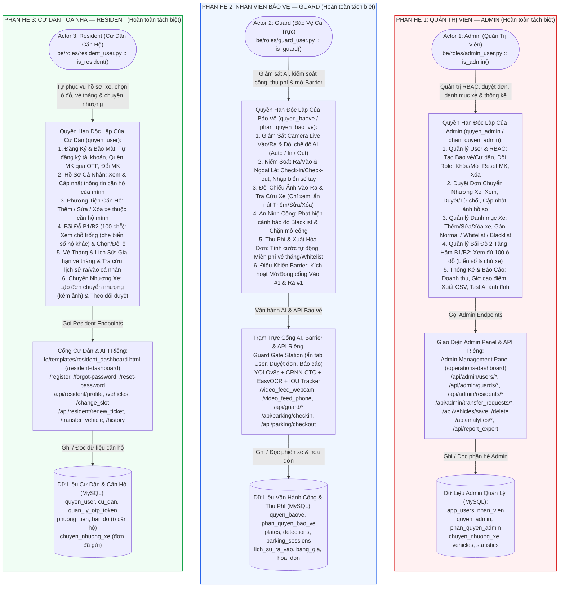
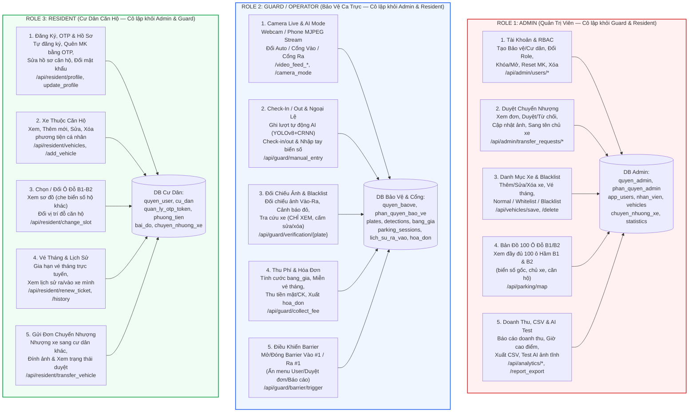
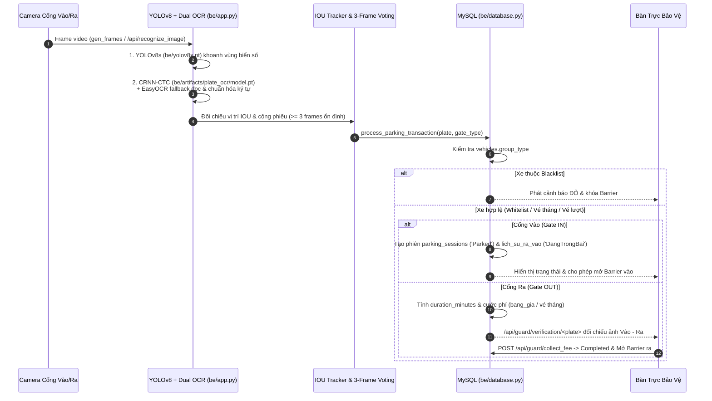

# Hệ Thống Quản Lý Bãi Đỗ Xe Thông Minh Ứng Dụng AI Nhận Diện Biển Số Xe (Smart Parking AI)

- **Đề tài**: Hệ thống Nhận diện Biển số xe & Quản lý Bãi đỗ xe Thông minh ứng dụng AI
- **Môn học**: Công nghệ phần mềm (CNPM24) — **Lớp**: `24CT2`
- **Sinh viên thực hiện**: Ông Thân Quốc Trường
- **Đơn vị**: Khoa Công nghệ thông tin — Trường Đại học Kiến trúc Đà Nẵng (DAU)
- **Repository**: [https://github.com/Truong027/CNPM24](https://github.com/Truong027/CNPM24)
- **Thư mục mã nguồn chính**: [`ongthanquoctruong_24CT2_cnpm/`](ongthanquoctruong_24CT2_cnpm/)

---

## 1. Tổng Quan Đề Tài & Sơ Đồ Kiến Trúc Phân Quyền (Bám Sát Đề Tài)

Hệ thống giải quyết bài toán kiểm soát phương tiện ra/vào chung cư, tòa nhà với bãi đỗ xe 2 tầng hầm (**Hầm B1** & **Hầm B2**, tổng **100 vị trí ô tô con** đánh số dãy `A..E` và `VIP`), kết hợp **Thị giác máy tính (YOLOv8s + CRNN-CTC + EasyOCR)** để nhận diện biển số theo thời gian thực, **phân quyền chặt chẽ 3 vai trò độc lập (`Admin`, `Guard`, `Resident`)** trên nền **Python Flask (`be/app.py`)** và **cơ sở dữ liệu duy nhất MySQL (`be/database.py` & `be/sql/httt_quan_ly_bai_xe_ai.sql`)**.

> **Lưu ý kiến trúc quan trọng (cho GitHub & GitDiagram)**:
> - Toàn bộ dữ liệu thật và nghiệp vụ của đề tài lưu trữ duy nhất trong **MySQL** (`be/database.py` & `be/sql/httt_quan_ly_bai_xe_ai.sql`). Thư mục `api/index.js` + `public/` chỉ là bản mô phỏng giao diện tĩnh xem thử trên Vercel, **không thuộc tầng CSDL (Persistence) của đề tài**.
> - Hệ thống chỉ có **3 vai trò độc lập (`Admin`, `Guard`, `Resident`)** nằm trên **3 phân hệ tách biệt hoàn toàn**:
>   - **Admin** chỉ thực hiện nghiệp vụ quản trị (`Quản lý User & RBAC`, `Phê duyệt đơn chuyển nhượng xe`, `Quản lý danh mục xe & Blacklist/Whitelist`, `Xem bản đồ 100 ô đỗ B1/B2`, `Thống kê doanh thu & Xuất báo cáo CSV`). **Admin KHÔNG sử dụng Bàn trực Bảo vệ ("guard view")**.
>   - **Guard (Bảo vệ / Operator)** chỉ thực hiện nghiệp vụ cổng (`Giám sát Camera AI Live`, `Đối chiếu ảnh Vào-Ra & Cảnh báo Blacklist`, `Ghi lượt Check-in/Check-out & Nhập biển số tay`, `Thu phí & Xuất hóa đơn`, `Mở/Đóng Barrier`).
>   - **Resident (Cư dân)** chỉ thực hiện nghiệp vụ cá nhân (`Đăng ký/OTP & Hồ sơ căn hộ`, `Thêm/Sửa/Xóa xe căn hộ`, `Chọn/Đổi ô đỗ B1/B2`, `Gia hạn vé tháng & Xem lịch sử cá nhân`, `Nộp đơn chuyển nhượng xe`).
> - Trên mọi sơ đồ kiến trúc, **mỗi mũi tên xuất phát từ `Admin`, `Guard`, `Resident` phải ghi rõ động từ nghiệp vụ cụ thể** (không vẽ mũi tên `"uses"` / `"user"` / `"uses guard view"`, không gộp `"Resident and admin services"` hay nút chung `Operations dashboard [index.html]`).

### Sơ Đồ Kiến Trúc 3 Quyền Tách Biệt Độc Lập (3 Isolated Role Lanes)

> **Nguyên tắc tách biệt**: Mỗi vai trò (`Admin`, `Guard`, `Resident`) là **1 luồng độc lập hoàn toàn** (Actor riêng -> Quyền hạn cụ thể -> API & Giao diện riêng -> Nhóm bảng MySQL riêng), **không nối chung một hộp trung tâm** và **không nối chéo giữa 3 phân hệ**.



---

## 2. Phân Rã Chi Tiết Quyền Hạn 3 Vai Trò Độc Lập (Strict 3-Role RBAC)

Hệ thống kiểm soát quyền truy cập đồng thời tại **3 lớp** để phân tách rạch ròi nghiệp vụ giữa **Quản trị viên (`Admin`)**, **Bảo vệ (`Guard / Operator`)** và **Cư dân (`Resident`)**:
1. **Tầng Backend Route Guard**: Hàm `is_admin()`, `is_guard()`, `is_resident()` (`be/roles/*.py`) + kiểm tra `session["user"]["role"]` tại các `@app.route` trong `be/app.py` (trả HTTP `403` hoặc điều hướng nếu truy cập sai vai trò).
2. **Tầng Giao diện Phân Khu Độc Lập (`fe/templates/index.html` -> `initAuthAndRole()`)**:
   - **Phân hệ Quản trị (`Admin Panel`)**: Khi tài khoản `Admin` đăng nhập `/operations-dashboard`, hệ thống hiển thị các phân hệ quản trị (`Quản lý User & RBAC`, `Phê duyệt đơn chuyển nhượng`, `Danh mục xe & Blacklist`, `Bản đồ 100 ô đỗ B1/B2`, `Thống kê doanh thu & Xuất CSV`), tách biệt khỏi nghiệp vụ trực cổng của Bảo vệ.
   - **Phân hệ Bảo vệ (`Guard Gate Station`)**: Khi tài khoản `Operator` / `Security` đăng nhập `/operations-dashboard`, hệ thống tự chuyển thẳng tới **Bàn Trực Bảo Vệ**, **ẩn hoàn toàn** các tab của Admin (`transfer-requests-page`, `users-page`, `reports-page`), ẩn nút thêm/sửa/xóa xe (`addVehicleBtn`) và khóa chỉnh sửa danh mục xe.
   - **Phân hệ Cư dân (`Resident Portal`)**: Tài khoản `Resident` truy cập riêng `/resident-dashboard` (`fe/templates/resident_dashboard.html`) và bị chặn hoàn toàn khỏi `/operations-dashboard`.
3. **Tầng Cơ sở dữ liệu MySQL**: Lưu cấu hình chi tiết quyền hạn tại các bảng `quyen_admin`, `quyen_baove`, `quyen_user` (`be/sql/httt_quan_ly_bai_xe_ai.sql`), `phan_quyen_admin`, `phan_quyen_bao_ve` (`be/database.py`) và mô tả trực quan trong `schema.dbml`.

### Sơ Đồ Chi Tiết Quyền Hạn -> API Endpoint -> Bảng Dữ Liệu Từng Role (Tách Rời 3 Làn Độc Lập)



### Ma Trận Phân Quyền Chi Tiết (RBAC Permission Matrix — Không Chồng Chéo)

> Chú giải: `✅ Toàn quyền thuộc vai trò` | `🔹 Chỉ phạm vi cá nhân / căn hộ` | `👁️ Chỉ xem` | `❌ Không thuộc phạm vi vai trò / Bị chặn`

| Nhóm Chức Năng | Chức Năng / Hành Động Cụ Thể | Role 1: `Admin` | Role 2: `Guard` (`Operator` / `Security`) | Role 3: `Resident` |
| :--- | :--- | :---: | :---: | :---: |
| **Xác thực & Hồ sơ** | Đăng ký tài khoản Cư dân (`/register`) & Quên MK OTP (`/forgot-password`) | ❌ | ❌ | ✅ |
| | Cập nhật hồ sơ căn hộ & Đổi mật khẩu (`/resident-dashboard`) | ❌ | ❌ | 🔹 |
| **Quản lý Tài khoản (RBAC)** | Xem danh sách tất cả tài khoản (Admin, Bảo vệ, Cư dân) | ✅ | ❌ | ❌ |
| | Tạo mới tài khoản Bảo vệ / Cư dân | ✅ | ❌ | ❌ |
| | Sửa thông tin, gán/đổi `role`, Khóa/Mở tài khoản, Reset MK, Xóa tài khoản | ✅ | ❌ | ❌ |
| **Chuyển nhượng xe** | Lập đơn chuyển nhượng xe + Upload ảnh giấy xác nhận | ❌ | ❌ | 🔹 |
| | Theo dõi trạng thái đơn chuyển nhượng của căn hộ mình | ❌ | ❌ | 🔹 |
| | Xem tất cả đơn, **Phê duyệt (`Approved`) / Từ chối (`Rejected`)**, sang tên xe & ô đỗ | ✅ | ❌ | ❌ |
| **Phương tiện & An ninh** | Thêm / Sửa / Xóa xe toàn bãi & Gán nhóm `Normal / Whitelist / Blacklist` | ✅ | ❌ *(ẩn nút, HTTP 403)* | ❌ |
| | Tra cứu danh mục phương tiện toàn bãi (`/api/vehicles`) | ✅ | 👁️ | ❌ |
| | Thêm / Sửa / Xóa xe thuộc căn hộ mình & Gia hạn vé tháng cá nhân | ❌ | ❌ | 🔹 |
| **Bãi đỗ 2 tầng hầm B1/B2** | Xem 100 ô đỗ `Ham_B1` / `Ham_B2` kèm **đủ biển số gốc & tên chủ xe** | ✅ | 👁️ | ❌ *(che biển số hộ khác)* |
| | Chọn mới hoặc đổi ô đỗ xe của căn hộ mình (`/api/resident/change_slot`) | ❌ | ❌ | 🔹 |
| **Trạm Bảo Vệ & Barrier** | Xem 2 Camera Live Vào/Ra & chuyển chế độ AI (`auto`/`in`/`out`) | ❌ | ✅ | ❌ |
| | Đối chiếu ảnh Vào – Ra, nhận cảnh báo `Blacklist` & nhập biển số thủ công | ❌ | ✅ | ❌ |
| | Check-in / Check-out, tính cước `bang_gia`, thu phí `hoa_don` & **Mở Barrier** | ❌ | ✅ | ❌ |
| **Lịch sử & Báo cáo** | Xem lịch sử ra/vào cá nhân của các xe thuộc căn hộ | ❌ | ❌ | 🔹 |
| | Báo cáo doanh thu, giờ cao điểm, biểu đồ tỉnh/loại xe & xuất CSV | ✅ | ❌ *(ẩn menu Reports)* | ❌ |
| | Upload ảnh tĩnh kiểm thử nhận diện AI (`/api/recognize_image`) | ✅ | ❌ | ❌ |

### Chi Tiết Module Kiểm Tra Quyền Trong Mã Nguồn

| Role | Giá trị `app_users.role` | Module kiểm tra quyền | Phân khu giao diện riêng | Bảng Phân Quyền DB |
| :--- | :--- | :--- | :--- | :--- |
| **1. Quản trị viên (`Admin`)** | `Admin` | `be/roles/admin_user.py` (`is_admin`) | Admin Management Panel (`/operations-dashboard`) | `quyen_admin`, `phan_quyen_admin` |
| **2. Bảo vệ (`Guard`)** | `Operator`, `Security` | `be/roles/guard_user.py` (`is_guard`) | Guard Gate & AI Station (`/operations-dashboard`, khóa menu Admin) | `quyen_baove`, `phan_quyen_bao_ve` |
| **3. Cư dân (`Resident`)** | `Resident` | `be/roles/resident_user.py` (`is_resident`) | Resident Portal (`/resident-dashboard`) | `quyen_user` |

### Nhiệm Vụ Riêng Biệt Của Từng Vai Trò (Isolated Workflows)

1. **Role 1 — Quản trị viên (`Admin`)**: Quản lý toàn bộ tài khoản và phân quyền (`app_users`, `nhan_vien`, `quyen_admin`, `phan_quyen_admin`), phê duyệt/từ chối đơn chuyển nhượng xe (`chuyen_nhuong_xe`), quản lý danh mục xe `Normal / Whitelist / Blacklist` (`vehicles`), theo dõi tổng quan 100 ô đỗ B1/B2 (`bai_do`), phân tích doanh thu/giờ cao điểm và xuất báo cáo CSV (`statistics`).
2. **Role 2 — Nhân viên Bảo vệ (`Guard` / `Operator`)**: Trực trạm kiểm soát cổng vào/ra, giám sát 2 luồng Camera Live AI (`YOLOv8s + CRNN-CTC + EasyOCR`), đối chiếu ảnh Vào – Ra, tiếp nhận cảnh báo đỏ xe `Blacklist`, nhập biển số thủ công khi ngoại lệ, thu phí theo `bang_gia` -> xuất `hoa_don` và điều khiển đóng/mở Barrier.
3. **Role 3 — Cư dân (`Resident`)**: Tự đăng ký (`/register`), khôi phục/đổi mật khẩu OTP, cập nhật hồ sơ căn hộ, tự thêm/sửa/xóa phương tiện cá nhân, chọn/đổi ô đỗ trong 100 chỗ Hầm B1/B2 (ẩn biển số căn hộ khác), gia hạn vé tháng, xem lịch sử ra/vào cá nhân và gửi đơn chuyển nhượng xe (`chuyen_nhuong_xe`).

---

## 3. Pipeline AI Nhận Diện Biển Số & Xử Lý Ra/Vào



- **Phát hiện vùng biển số**: [`ongthanquoctruong_24CT2_cnpm/be/yolov8s.pt`](ongthanquoctruong_24CT2_cnpm/be/yolov8s.pt) (`ultralytics` YOLOv8s).
- **Nhận diện ký tự quang học kép (Dual OCR)**:
  - [`ongthanquoctruong_24CT2_cnpm/be/plate_ocr_inference.py`](ongthanquoctruong_24CT2_cnpm/be/plate_ocr_inference.py) & [`artifacts/plate_ocr/model.pt`](ongthanquoctruong_24CT2_cnpm/be/artifacts/plate_ocr/model.pt) + [`vocab.json`](ongthanquoctruong_24CT2_cnpm/be/artifacts/plate_ocr/vocab.json): mô hình CRNN-CTC huấn luyện chuyên biệt cho biển số Việt Nam.
  - [`ongthanquoctruong_24CT2_cnpm/be/crnn_ocr_wrapper.py`](ongthanquoctruong_24CT2_cnpm/be/crnn_ocr_wrapper.py) & [`plate_ocr_integration.py`](ongthanquoctruong_24CT2_cnpm/be/plate_ocr_integration.py): kết hợp EasyOCR fallback khi khung hình mờ/nghiêng và chuẩn hóa định dạng biển số Việt Nam.
- **Lọc nhiễu chuyển động**: Tracking dựa trên IOU và bỏ phiếu 3 khung hình liên tiếp trước khi ghi DB.

---

## 4. Thiết Kế Cơ Sở Dữ Liệu MySQL (Dual-Sync Architecture)

Mã nguồn CSDL được định nghĩa trong [`ongthanquoctruong_24CT2_cnpm/be/database.py`](ongthanquoctruong_24CT2_cnpm/be/database.py), [`be/sql/httt_quan_ly_bai_xe_ai.sql`](ongthanquoctruong_24CT2_cnpm/be/sql/httt_quan_ly_bai_xe_ai.sql) và mô tả trực quan tại [`schema.dbml`](ongthanquoctruong_24CT2_cnpm/schema.dbml):

1. **Nhóm bảng Tài khoản, OTP & Phân quyền 3 Role**:
   - `app_users`, `nhan_vien`, `cu_dan`, `lich_su_dang_nhap`, `quan_ly_otp_token`
   - `quyen_admin`, `quyen_baove`, `quyen_user`, `phan_quyen_admin`, `phan_quyen_bao_ve`
2. **Nhóm bảng AI Nhận diện & Phiên đỗ xe**:
   - `provinces`, `vehicle_types`, `plates`, `detections`, `parking_sessions`, `vehicles`, `statistics`
3. **Nhóm bảng Nghiệp vụ Chung cư & Thanh toán**:
   - `bai_do` (100 vị trí ô tô 2 tầng `Ham_B1` và `Ham_B2`, chia theo dãy `A..E`, trạng thái `Trong` / `DaDat` / `BaoTri`)
   - `phuong_tien`, `chuyen_nhuong_xe`, `lich_su_ra_vao`, `bang_gia`, `hoa_don`
   - Trigger toàn vẹn `trg_KhongXoaCuDan_KhiXeTrongBai` ngăn xóa cư dân khi phương tiện vẫn đang trong bãi (`DangTrongBai`).

---

## 5. Danh Mục API Endpoints Đầy Đủ (Backend Flask — `be/app.py`)

### A. Cổng Xác Thực Dùng Chung (Authentication & Portal)
| Method | Endpoint | Chức năng |
| :--- | :--- | :--- |
| `GET` | `/`, `/api/public/dashboard` | Trang tổng quan bãi B1/B2 trước khi đăng nhập (dẫn tới Đăng nhập / Đăng ký) |
| `GET`, `POST` | `/login`, `/api/login`, `/api/session`, `/api/logout` | Đăng nhập, kiểm tra phiên làm việc và điều hướng theo role |
| `GET`, `POST` | `/register`, `/api/register` | Đăng ký tài khoản cư dân mới (kèm xe & vị trí đỗ) |
| `GET`, `POST` | `/forgot-password`, `/api/forgot-password`, `/reset-password`, `/api/reset-password` | Tạo mã OTP & đặt lại mật khẩu |

### B. Role 1 — Quản trị viên (`Admin`)
| Method | Endpoint | Chức năng |
| :--- | :--- | :--- |
| `GET` | `/operations-dashboard` | Bảng điều khiển quản trị & vận hành |
| `GET`, `POST`, `DELETE` | `/api/admin/users`, `/api/admin/guards/create`, `/api/admin/residents/create`, `/api/admin/users/update`, `/api/admin/users/toggle_status`, `/api/admin/users/reset_password`, `/api/admin/users/<phone>`, `/api/admin/guards/update`, `/api/admin/guards/<username>` | Quản lý toàn bộ tài khoản Bảo vệ & Cư dân, phân vai trò, khóa/mở, đặt lại mật khẩu |
| `GET`, `POST` | `/api/admin/transfer_requests`, `/api/admin/transfer_requests/<id>/action`, `/api/admin/transfer_requests/<id>/update_doc` | Xem danh sách đơn chuyển nhượng, phê duyệt/từ chối và cập nhật ảnh hồ sơ |
| `GET`, `POST`, `DELETE` | `/api/vehicles`, `/api/vehicles/save`, `/api/vehicles/delete/<plate_text>` | Quản lý danh mục xe & phân nhóm `Normal / Whitelist / Blacklist` |
| `GET` | `/get_dashboard_summary`, `/get_statistics`, `/get_stats_by_province`, `/get_stats_by_vehicle_type`, `/api/analytics/revenue`, `/api/analytics/peak-hours`, `/api/report_export` | Thống kê KPI, doanh thu, giờ cao điểm, tỷ lệ tỉnh/loại xe và xuất báo cáo CSV |
| `POST` | `/api/recognize_image` | Tải ảnh tĩnh lên kiểm thử nhận diện biển số AI |

### C. Role 2 — Nhân viên Bảo vệ (`Operator / Security`)
| Method | Endpoint | Chức năng |
| :--- | :--- | :--- |
| `GET` | `/video_feed_webcam`, `/video_feed_phone` | Luồng video MJPEG trực tiếp kèm khung nhận diện AI |
| `GET`, `POST` | `/api/guard/camera_mode`, `/api/guard/latest_event`, `/api/guard/initial_plate` | Chuyển chế độ AI Auto/Thủ công & cập nhật sự kiện xe mới nhất |
| `GET`, `POST` | `/api/guard/verification/<plate>`, `/api/guard/manual_entry`, `/api/guard/collect_fee`, `/api/guard/barrier/trigger` | Đối chiếu ảnh Vào – Ra, nhập tay biển số, thu cước phí & kích hoạt Barrier |
| `GET`, `POST` | `/api/parking/sessions`, `/api/parking/checkin`, `/api/parking/checkout/<session_id>` | Quản lý phiên xe vào/ra và checkout thủ công |
| `GET` | `/get_plates`, `/get_plate_details/<plate_text>`, `/get_plate_detections/<plate_text>` | Tra cứu lịch sử biển số & chi tiết các lần quét AI |

### D. Role 3 — Cư dân (`Resident`)
| Method | Endpoint | Chức năng |
| :--- | :--- | :--- |
| `GET` | `/resident-dashboard` | Cổng dịch vụ Cư dân |
| `GET`, `POST` | `/api/resident/profile`, `/api/resident/update_profile`, `/api/resident/change_password` | Xem, cập nhật hồ sơ cá nhân & đổi mật khẩu |
| `GET`, `POST`, `PUT`, `DELETE` | `/api/resident/vehicles`, `/api/resident/add_vehicle`, `/api/resident/vehicles/<plate>` | Quản lý danh sách xe đã đăng ký của căn hộ |
| `GET`, `POST` | `/api/parking/map`, `/api/resident/change_slot` | Xem sơ đồ bãi đỗ 100 chỗ B1/B2 & chọn/đổi vị trí đỗ xe |
| `GET`, `POST` | `/api/resident/renew_ticket`, `/api/resident/transfer_vehicle`, `/api/resident/transfer_requests`, `/api/resident/history` | Gia hạn vé tháng, lập/theo dõi đơn chuyển nhượng xe & xem lịch sử ra vào |

---

## 6. Tài Liệu Phân Tích, Thiết Kế & Quản Trị Dự Án (`docs/`)

- **Biểu đồ Tuần tự (Sequence Diagrams)** — `docs/Tuần Tự/`:
  - Chức năng Đăng ký người dùng, Đăng nhập đa vai trò, Phê duyệt đơn chuyển nhượng Admin, Quản lý và phân quyền người dùng Admin (`.drawio` + `.png`).
- **Biểu đồ Luồng Xử Lý & Wireframe** — `docs/LUONGXULY/` & `docs/Wireframe/`:
  - Các sơ đồ luồng xử lý chi tiết + bộ phác thảo Wireframe cho Dashboard công khai, Đăng ký, Đăng nhập, Duyệt đơn chuyển nhượng, Phân quyền Admin.
- **Sơ đồ Mạng PERT / CPM** — `docs/PERT/` ([`BANG_THONG_SO_PERT.md`](ongthanquoctruong_24CT2_cnpm/docs/PERT/BANG_THONG_SO_PERT.md), [`SO_DO_PERT_DE_1.drawio`](ongthanquoctruong_24CT2_cnpm/docs/PERT/SO_DO_PERT_DE_1.drawio)):
  - Tính toán theo phương pháp $t_s(i)$, $t_m(i)$ và $t_{df}(cv)$ với đỉnh tách `7` (`4 → 7: t_G = 15`, hai cung giả `t'_G` tới `5` và `8`): **Đường găng `A → D → G → J`** (`[0] → (1) → (4) → (7) --t'G--> (8) → [9]`), tổng thời gian hoàn thành dự án **$T_{max} = 38$ ngày**.
- **Báo cáo Tổng hợp Word / PDF** — `docs/Word báo cáo/BAOCAOBANNOP.docx` & `BAOCAOBANNOP.pdf`:
  - Đầy đủ Chương 1 & Chương 2 (46 trang): Lý thuyết, Tuần tự, PERT/CPM, Demo 3 bước thiết kế UI/UX, truy vấn SQL thống kê tổng/từng hầm (`Ham_B1`, `Ham_B2`) & thống kê vai trò (`app_users`), ERD, Data Dictionary & dữ liệu thực nghiệm MySQL `httt_quanlybaixe_ai`.

---

## 7. Cấu Trúc Thư Mục Dự Án (Project Tree)

```text
CNPM24/
├── README.md                                         # Tài liệu tổng quan kiến trúc & 3 Role (GitHub & GitDiagram)
├── .gitignore                                        # Quy tắc loại trừ file môi trường (.env), cache & dataset thô
└── ongthanquoctruong_24CT2_cnpm/
    ├── README.md                                     # Tài liệu chi tiết bên trong thư mục dự án
    ├── vercel.json                                   # Cấu hình rewrite & deploy Vercel (Static SPA + Serverless API)
    ├── package.json                                  # Metadata Node.js cho môi trường frontend/Vercel
    ├── requirements.txt                              # Danh sách thư viện Python (Flask, Torch, Ultralytics, EasyOCR, MySQL)
    ├── schema.dbml                                   # Lược đồ quan hệ DBML phục vụ trực quan hóa ERD & 3 Role
    ├── .env.example                                  # Mẫu biến môi trường kết nối MySQL & APP_SECRET_KEY
    │
    ├── api/                                          # Bản giả lập xem thử UI trên Vercel (không thuộc CSDL thật của đề tài)
    │   ├── index.js                                  # Dữ liệu mô phỏng xem nhanh giao diện tĩnh
    │   └── [...slug].js                              # Catch-all route trỏ về index.js
    │
    ├── public/                                       # Bản tĩnh xem thử UI trên Vercel (bản chính thức chạy từ fe/templates/)
    │   ├── index.html                                # Giao diện Vận hành chính / Guard Station
    │   ├── public-dashboard.html / public_dashboard.html
    │   ├── operations-dashboard.html / operations_dashboard.html
    │   ├── resident-dashboard.html / resident_dashboard.html
    │   ├── login.html, register.html
    │   ├── forgot-password.html / forgot_password.html
    │   ├── reset-password.html / reset_password.html
    │   └── camera_entry.svg, camera_exit.svg
    │
    ├── fe/                                           # PHÂN HỆ FRONTEND LOCAL (JINJA2 TEMPLATES)
    │   ├── templates/
    │   │   ├── public_dashboard.html                 # Trang tổng quan chung (/)
    │   │   ├── index.html                            # Phân khu Admin Panel & phân khu Guard Gate Station (/operations-dashboard, tách quyền qua initAuthAndRole)
    │   │   ├── resident_dashboard.html               # Cổng dịch vụ Cư dân & Bản đồ 100 ô đỗ B1/B2 (/resident-dashboard)
    │   │   ├── login.html, register.html
    │   │   └── forgot_password.html, reset_password.html
    │   └── README.md
    │
    ├── be/                                           # PHÂN HỆ BACKEND FLASK + AI CORE + MYSQL
    │   ├── app.py                                    # Web Server Flask, RESTful APIs, Camera Streaming & Auth Session
    │   ├── database.py                               # Module kết nối MySQL, khởi tạo bảng, seed tài khoản & nghiệp vụ Dual-Sync
    │   ├── setup_bai_do.py                           # Khởi tạo 100 vị trí đỗ ô tô (Ham_B1, Ham_B2)
    │   ├── plate_ocr_inference.py                    # Suy luận OCR CRNN-CTC biển số xe
    │   ├── plate_ocr_integration.py                  # Tích hợp YOLOv8 + CRNN-CTC + EasyOCR fallback
    │   ├── crnn_ocr_wrapper.py                       # Wrapper chuẩn hóa đầu ra OCR
    │   ├── yolov8s.pt                                # Trọng số YOLOv8 phát hiện biển số
    │   ├── artifacts/plate_ocr/                      # model.pt & vocab.json (CRNN-CTC)
    │   ├── roles/                                    # Phân rã hàm kiểm tra & điều hướng 3 Vai trò
    │   │   ├── admin_user.py                         # Role Admin
    │   │   ├── guard_user.py                         # Role Operator / Security (Bảo vệ)
    │   │   └── resident_user.py                      # Role Resident (Cư dân)
    │   ├── sql/
    │   │   ├── httt_quan_ly_bai_xe_ai.sql            # Script DDL + Trigger MySQL đầy đủ
    │   │   └── bien_so_xe_sample.sql                 # Dữ liệu mẫu biển số & tỉnh thành
    │   ├── scripts/                                  # Công cụ tạo/kiểm tra DB & huấn luyện OCR
    │   ├── requirements.txt
    │   └── README.md
    │
    ├── tests/                                        # BỘ KIỂM THỬ TỰ ĐỘNG (UNIT & INTEGRATION TESTS)
    │   ├── test_full_features.py                     # Kiểm thử toàn trình 3 Role, chuyển nhượng xe & phân quyền
    │   ├── test_user_management.py                   # Kiểm thử quản lý người dùng, reset mật khẩu & RBAC
    │   ├── test_cinema_parking.py                    # Kiểm thử sơ đồ 100 ô đỗ B1/B2
    │   ├── test_sample_logins.py, test_api_simple.py, test_detection.py, test_save_plate.py, test_get_plates_func.py, test_http_request.py
    │   └── README.md
    │
    ├── docs/                                         # TÀI LIỆU CNPM, BIỂU ĐỒ & BÁO CÁO
    │   ├── Tuần Tự/                                  # Sơ đồ tuần tự (.drawio & .png)
    │   ├── LUONGXULY/                                # Sơ đồ luồng xử lý (.drawio, .png & script render)
    │   ├── PERT/                                     # Sơ đồ PERT/CPM Đề 1, bảng thông số & tài liệu hướng dẫn
    │   ├── Wireframe/                                # Wireframe giao diện các màn hình chính
    │   ├── Word báo cáo/                             # BAOCAOBANNOP.docx, BAOCAOBANNOP.pdf
    │   ├── drawio/                                   # Bộ 13 Use Case chi tiết (uc01 -> uc13)
    │   ├── KHAO_SAT_YEU_CAU.md, HE_THONG_VA_LUONG_XU_LY.md, ERD_DIAGRAM.md
    │   └── USE_CASE_DIAGRAMS.puml, USE_CASE_ACTORS_DETAILED.puml, SEQUENCE_DIAGRAMS.puml
    │
    └── doc_images/                                   # Kho ảnh sơ đồ & giao diện thực tế chèn báo cáo
```

---

## 8. Hướng Dẫn Cài Đặt, Khởi Chạy & Kiểm Thử

### A. Chạy Cục Bộ (Local Full-Stack: Flask + YOLOv8/CRNN + MySQL)

1. **Di chuyển vào thư mục dự án và kích hoạt môi trường ảo (`.venv`):**
   ```powershell
   cd ongthanquoctruong_24CT2_cnpm
   .venv\Scripts\activate
   ```
2. **Cài đặt thư viện (nếu chưa có `.venv`):**
   ```powershell
   pip install -r requirements.txt
   ```
3. **Cấu hình MySQL:**
   - Khởi động MySQL (`localhost:3306`), sao chép `.env.example` thành `.env` và điền `MYSQL_HOST`, `MYSQL_USER`, `MYSQL_PASSWORD`, `MYSQL_DATABASE`, `APP_SECRET_KEY`.
   - Khởi tạo bảng và dữ liệu 100 ô đỗ 2 tầng hầm (`Ham_B1`, `Ham_B2`):
     ```powershell
     python be/setup_bai_do.py
     ```
4. **Khởi chạy máy chủ Backend Flask (tự động kích hoạt `.venv` nếu chạy từ Python hệ thống):**
   ```powershell
   python be/app.py
   ```
   Truy cập: **http://127.0.0.1:5000**

5. **Tài khoản mẫu khởi tạo sẵn (`be/database.py` -> `seed_default_users`)**:
   - **Admin**: SĐT `0900000001` (`admin`) | **Bảo vệ (Operator)**: `0912345678` (`baove1`), `0923456789` (`baove2`) | **Cư dân (Resident)**: `0901234567` (`cudan1`), `0907654321` (`cudan2`) *(xem mật khẩu seed trong `be/database.py`)*

### B. Chạy Kiểm Thử Tự Động

```powershell
cd ongthanquoctruong_24CT2_cnpm
python -m unittest discover -s tests -p "test_*.py"
```

### C. Xem Nhanh Giao Diện Tĩnh Trên Vercel (Tùy Chọn Phụ Trợ)

- [`ongthanquoctruong_24CT2_cnpm/vercel.json`](ongthanquoctruong_24CT2_cnpm/vercel.json) và [`api/index.js`](ongthanquoctruong_24CT2_cnpm/api/index.js) chỉ phục vụ xem thử giao diện tĩnh từ `public/` bằng dữ liệu mẫu; hệ thống chính thức của đề tài chạy bằng **Python Flask (`be/app.py`) + AI + MySQL (`be/database.py`)**.

---

## 9. Tùy Biến Sơ Đồ Chi Tiết Trên GitDiagram (`gitdiagram.com`)

Mặc định `gitdiagram.com` sử dụng AI quét cây thư mục file (`index.html`, `app.py`, `database.py`), nên khi bấm **Regenerate** đơn thuần có thể vẫn gom chung giao diện hoặc sinh các nhãn chung chung kiểu `"uses"` / `"uses guard view"`. Để hiển thị chính xác tuyệt đối **3 vai trò tách biệt, không mũi tên `"uses"` ở Admin / Guard / Resident** trên [GitDiagram (Truong027/CNPM24)](https://gitdiagram.com/Truong027/CNPM24), bấm nút **`Modify`** ngay trên trang GitDiagram và dán đoạn hướng dẫn sau:

```text
CRITICAL THESIS ARCHITECTURE & LAYOUT RULES:
1. EXCLUDE Vercel/static mock files completely! Do NOT include "Mock State [index.js]", "Serverless API [index.js]", "Static web client", or any mock persistence cylinder. The ONLY Database / Persistence in this project is MySQL ("httt_quanlybaixe_ai" via be/database.py & be/sql/httt_quan_ly_bai_xe_ai.sql).
2. FORBIDDEN LABELS, MERGED BOXES & ARROWS (MUST OBEY FOR ALL 3 ACTORS):
   - NEVER output the arrow label "uses", "user", "uses guard view", "operates", or "checks role" from ANY actor (NOT from Admin/Administrator, NOT from Guard, NOT from Resident)!
   - Admin MUST NOT have "uses" or "uses guard view" arrows! Admin does NOT operate Guard Gate Station and MUST NOT point to a shared "Operations dashboard [index.html]".
   - Resident MUST NOT have a "uses" arrow!
   - NEVER create shared hubs named "Resident and admin services", "Users and access", "Access and Roles", "Web Dashboards", or "Operations dashboard [index.html]".
   - Do NOT label parking slots as "Cinema parking slots"; call it "B1/B2 100-Slot Parking Layout [setup_bai_do.py]".
3. Create 3 COMPLETELY SEPARATE, DISCONNECTED subgraphs / vertical swimlanes — ONE for Admin, ONE for Guard, ONE for Resident — with ZERO crossing edges between them:
  1) Subgraph 1 — "Role 1: Admin (be/roles/admin_user.py)" (Red):
     Actor circle "Admin" draws ONLY these 5 explicit Admin action arrows (zero "uses", zero "uses guard view"):
     - -- "manages users & RBAC" --> User & RBAC Admin (/api/admin/users/*, /guards/create, /residents/create, toggle_status, reset_password)
     - -- "approves/rejects transfers" --> Transfer Request Approval (/api/admin/transfer_requests/* -> chuyen_nhuong_xe)
     - -- "manages vehicles & Blacklist" --> Vehicle & Whitelist/Blacklist Master (/api/vehicles/save, /delete)
     - -- "views full 100-slot B1/B2 map" --> B1/B2 Parking Admin Overview (/api/parking/map, setup_bai_do.py)
     - -- "views revenue & exports CSV" --> Revenue Analytics & CSV Export (/api/analytics/*, /api/report_export)
     -> MySQL Admin DB "(quyen_admin, phan_quyen_admin, app_users, nhan_vien, vehicles, chuyen_nhuong_xe, statistics)".
  2) Subgraph 2 — "Role 2: Guard / Operator (be/roles/guard_user.py)" (Blue):
     Actor circle "Guard" draws ONLY these 5 explicit Guard action arrows (zero "uses", zero "operates"):
     - -- "monitors live IN/OUT AI cameras" --> Live Camera & AI Mode (/video_feed_*, /api/guard/camera_mode, YOLOv8s + CRNN-CTC + EasyOCR)
     - -- "verifies plates & Blacklist alerts" --> Gate Verification & Read-Only Lookup (/api/guard/verification/{plate}, /api/vehicles)
     - -- "logs check-in/out & manual plate" --> Manual Gate Entry & Sessions (/api/guard/manual_entry, /api/parking/checkin, /checkout)
     - -- "calculates fees & issues receipts" --> Fee Collection & Billing (/api/guard/collect_fee)
     - -- "triggers IN/OUT barriers" --> Barrier Controller (/api/guard/barrier/trigger)
     -> MySQL Guard DB "(quyen_baove, phan_quyen_bao_ve, plates, detections, parking_sessions, lich_su_ra_vao, bang_gia, hoa_don)".
  3) Subgraph 3 — "Role 3: Resident (be/roles/resident_user.py)" (Green):
     Actor circle "Resident" draws ONLY these 5 explicit Resident action arrows (zero "uses", never "User"):
     - -- "registers, resets OTP & edits profile" --> Resident Auth & Profile (/register, /forgot-password, /api/resident/profile, update_profile)
     - -- "adds/edits/deletes apartment vehicles" --> Apartment Vehicle CRUD (/api/resident/vehicles, /add_vehicle)
     - -- "selects/changes B1/B2 parking slot" --> B1/B2 Slot Selection (/api/resident/change_slot)
     - -- "renews monthly ticket & views history" --> Ticket Renewal & Personal History (/api/resident/renew_ticket, /history)
     - -- "submits vehicle transfer request" --> Vehicle Transfer Submission (/api/resident/transfer_vehicle)
     -> MySQL Resident DB "(quyen_user, cu_dan, quan_ly_otp_token, phuong_tien, bai_do, chuyen_nhuong_xe)".
- Do NOT include any 4th actor ("Public visitor", "Guest") and keep ZERO cross-links between Subgraph 1, Subgraph 2, and Subgraph 3.
```
