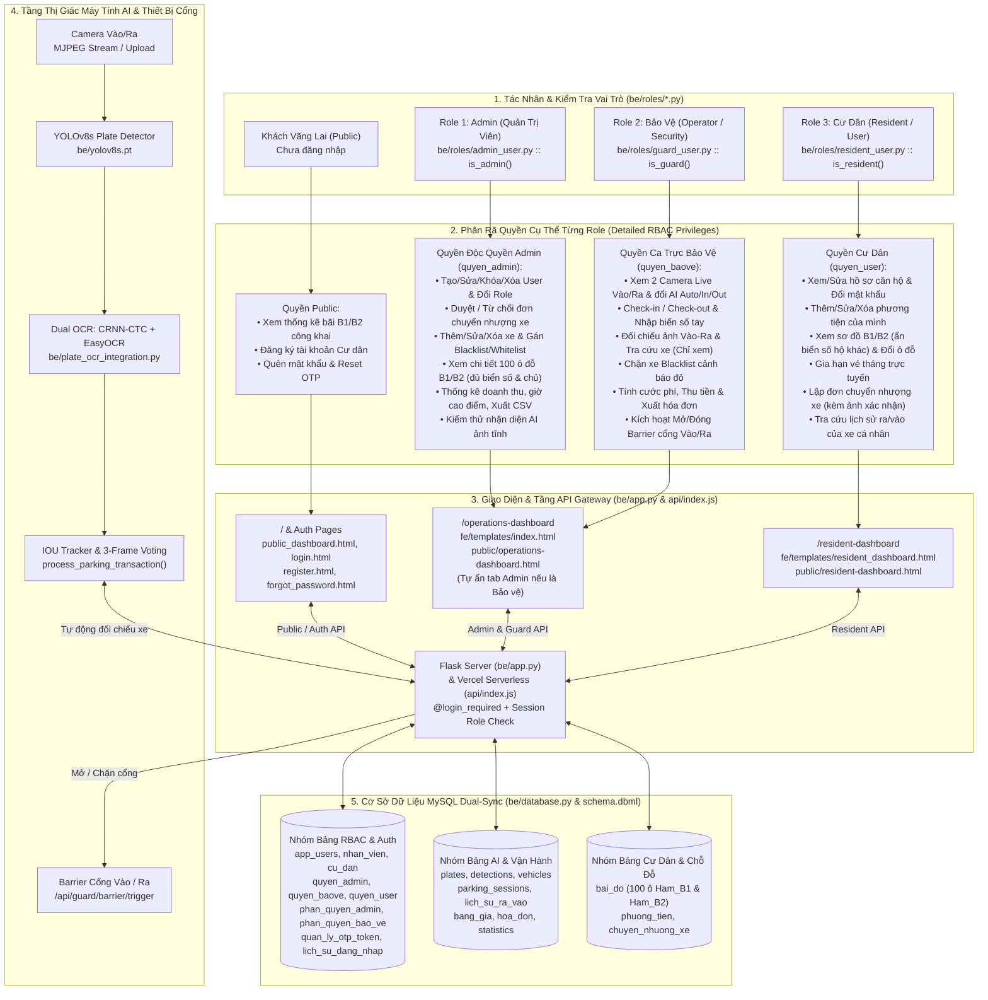

# Hệ Thống Quản Lý Bãi Đỗ Xe Thông Minh Ứng Dụng AI Nhận Diện Biển Số Xe (Smart Parking AI)

- **Đề tài**: Hệ thống Nhận diện Biển số xe & Quản lý Bãi đỗ xe Thông minh ứng dụng AI
- **Môn học**: Công nghệ phần mềm (CNPM24) — **Lớp**: `24CT2`
- **Sinh viên thực hiện**: Ông Thân Quốc Trường
- **Đơn vị**: Khoa Công nghệ thông tin — Trường Đại học Kiến trúc Đà Nẵng (DAU)
- **Repository**: [https://github.com/Truong027/CNPM24](https://github.com/Truong027/CNPM24)
- **Thư mục mã nguồn chính**: [`ongthanquoctruong_24CT2_cnpm/`](ongthanquoctruong_24CT2_cnpm/)

---

## 1. Tổng Quan Đề Tài & Sơ Đồ Kiến Trúc Phân Quyền (GitDiagram Architecture)

Hệ thống giải quyết bài toán kiểm soát phương tiện ra/vào chung cư, tòa nhà và bãi đỗ xe 2 tầng hầm (**Hầm B1** & **Hầm B2**, tổng **100 vị trí ô tô con** thiết kế theo sơ đồ rạp chiếu phim — Cinema Parking Map), kết hợp **Thị giác máy tính (YOLOv8s + CRNN-CTC + EasyOCR)** để nhận diện biển số theo thời gian thực, **phân quyền chặt chẽ 3 vai trò (RBAC: Admin, Guard/Operator, Resident)** và **kiến trúc triển khai song song** (Python Flask đầy đủ AI + MySQL chạy Local, đồng thời hỗ trợ bản Static SPA + Vercel Serverless Node.js API).

### Sơ Đồ Kiến Trúc Tổng Thể & Luồng Quyền Hạn (Cho GitHub & GitDiagram)



---

## 2. Phân Rã Chi Tiết Quyền Hạn 3 Vai Trò (Detailed 3-Role RBAC Permissions)

Hệ thống kiểm soát quyền truy cập đồng thời tại **3 lớp** để đảm bảo bảo mật và đúng nghiệp vụ:
1. **Tầng Backend Route Guard**: Hàm `is_admin()`, `is_guard()`, `is_resident()` (`be/roles/*.py`) + kiểm tra `session["user"]["role"]` tại các `@app.route` trong `be/app.py` (trả HTTP `403` hoặc điều hướng nếu sai quyền).
2. **Tầng Giao diện (`fe/templates/index.html` -> `initAuthAndRole()`)**: Khi tài khoản **Bảo vệ** (`Operator` / `Security`) đăng nhập `/operations-dashboard`, hệ thống tự chuyển thẳng tới tab **Bàn Trực Bảo Vệ**, **ẩn hoàn toàn** 3 menu chỉ dành cho Admin (`transfer-requests-page`, `users-page`, `reports-page`), ẩn nút thêm/sửa/xóa xe (`addVehicleBtn`) và chuyển danh mục xe sang **chế độ Chỉ xem**. Khi **Cư dân** (`Resident`) truy cập `/operations-dashboard`, backend ép điều hướng về `/resident-dashboard`.
3. **Tầng Cơ sở dữ liệu MySQL**: Lưu cấu hình chi tiết quyền hạn tại các bảng `quyen_admin`, `quyen_baove`, `quyen_user` (`be/sql/httt_quan_ly_bai_xe_ai.sql`), `phan_quyen_admin`, `phan_quyen_bao_ve` (`be/database.py`) và mô tả trực quan trong `schema.dbml`.

### Sơ Đồ Chi Tiết Quyền Hạn -> API Endpoint -> Bảng Dữ Liệu Từng Role

```mermaid
flowchart LR
    %% ================= ROLE 1: ADMIN =================
    subgraph Role1["ROLE 1: ADMIN (Quản Trị Viên - Toàn quyền hệ thống)"]
        direction TB
        A_Users["1. Quản lý Tài khoản & Phân quyền<br/>• Tạo Bảo vệ / Cư dân mới<br/>• Sửa thông tin & Đổi Role<br/>• Khóa/Mở khóa & Reset MK<br/>• Xóa tài khoản<br/>API: /api/admin/users/*, /guards/*, /residents/*"]
        A_Transfer["2. Phê duyệt Đơn Chuyển Nhượng<br/>• Xem danh sách chờ duyệt<br/>• Duyệt / Từ chối đơn chuyển xe<br/>• Cập nhật ảnh hồ sơ xác nhận<br/>• Tự động sang tên xe & ô đỗ<br/>API: /api/admin/transfer_requests/*"]
        A_Veh["3. Quản lý Xe & Phân nhóm An ninh<br/>• Thêm / Sửa / Xóa thông tin xe<br/>• Gia hạn vé tháng cho xe<br/>• Phân nhóm Normal / Whitelist / Blacklist<br/>API: /api/vehicles/save, /delete"]
        A_Map["4. Giám sát Bãi Đỗ Cinema (Full)<br/>• Xem sơ đồ 100 ô Hầm B1 & B2<br/>• Xem đầy đủ biển số, chủ xe, căn hộ<br/>API: /api/parking/map (Admin mode)"]
        A_Stat["5. Thống Kê, Doanh Thu & AI Test<br/>• Báo cáo doanh thu & giờ cao điểm<br/>• Xuất file báo cáo CSV<br/>• Upload ảnh test nhận diện AI<br/>API: /api/analytics/*, /api/report_export"]
    end

    %% ================= ROLE 2: GUARD / OPERATOR =================
    subgraph Role2["ROLE 2: GUARD / OPERATOR (Bảo Vệ Ca Trực - Chỉ vận hành cổng)"]
        direction TB
        G_Cam["1. Giám Sát Camera & Chế Độ AI<br/>• Xem MJPEG Live Webcam / Phone<br/>• Đổi chế độ: Tự động / Cổng Vào / Cổng Ra<br/>API: /video_feed_*, /api/guard/camera_mode"]
        G_Gate["2. Kiểm Soát Vào/Ra & Ngoại Lệ<br/>• Ghi nhận lượt xe vào/ra tự động<br/>• Check-in / Check-out thủ công<br/>• Nhập biển số tay khi mờ/bẩn<br/>API: /api/guard/manual_entry, /api/parking/checkin|checkout"]
        G_Verify["3. Đối Chiếu Ảnh & An Ninh Blacklist<br/>• Đối chiếu ảnh xe lúc vào - lúc ra<br/>• Cảnh báo đỏ & Khóa cổng xe Blacklist<br/>• Tra cứu danh mục xe (CHỈ XEM, không sửa/xóa)<br/>API: /api/guard/verification/{plate}, /api/vehicles"]
        G_Fee["4. Thu Phí & Xuất Hóa Đơn<br/>• Tự động tính phí theo thời gian gửi<br/>• Miễn phí xe Whitelist / Vé tháng còn hạn<br/>• Thu tiền mặt/CK & Sinh mã hóa đơn<br/>API: /api/guard/collect_fee"]
        G_Bar["5. Điều Khiển Barrier Vào / Ra<br/>• Kích hoạt mở/đóng Barrier cổng Vào #1 / Ra #1<br/>• Hạn chế: ẨN menu User, Duyệt đơn, Báo cáo<br/>API: /api/guard/barrier/trigger"]
    end

    %% ================= ROLE 3: RESIDENT =================
    subgraph Role3["ROLE 3: RESIDENT (Cư Dân - Tự phục vụ trong phạm vi căn hộ)"]
        direction TB
        R_Prof["1. Hồ Sơ Cá Nhân & Bảo Mật<br/>• Đăng ký tài khoản & Quên MK bằng OTP<br/>• Xem/Cập nhật họ tên, căn hộ, SĐT, email<br/>• Đổi mật khẩu cá nhân<br/>API: /api/register, /forgot-password, /api/resident/profile|update_profile|change_password"]
        R_Veh["2. Quản Lý Xe Căn Hộ<br/>• Xem danh sách xe đã đăng ký của mình<br/>• Thêm mới / Sửa / Xóa phương tiện<br/>API: /api/resident/vehicles, /add_vehicle"]
        R_Slot["3. Sơ Đồ Bãi Đỗ Cinema B1/B2<br/>• Xem tình trạng Trống/Đã đặt (che biển số hộ khác)<br/>• Chọn hoặc Đổi ô đỗ xe của căn hộ<br/>API: /api/parking/map, /api/resident/change_slot"]
        R_Ticket["4. Gia Hạn Vé Tháng & Lịch Sử<br/>• Gia hạn vé tháng cho xe đang sở hữu<br/>• Tra cứu lịch sử ra/vào & phí của xe mình<br/>API: /api/resident/renew_ticket, /api/resident/history"]
        R_Trans["5. Lập Đơn Chuyển Nhượng Xe<br/>• Gửi yêu cầu nhượng xe sang cư dân khác<br/>• Đính kèm ảnh giấy xác nhận & Theo dõi trạng thái<br/>API: /api/resident/transfer_vehicle, /transfer_requests"]
    end

    %% ================= DATABASE TARGETS =================
    subgraph DBTables["CƠ SỞ DỮ LIỆU MYSQL TÁC ĐỘNG"]
        direction TB
        T_Auth[("app_users, nhan_vien, cu_dan<br/>quyen_admin, quyen_baove, quyen_user<br/>quan_ly_otp_token, lich_su_dang_nhap")]
        T_Core[("phuong_tien, vehicles, bai_do<br/>chuyen_nhuong_xe")]
        T_Logs[("plates, detections, parking_sessions<br/>lich_su_ra_vao, bang_gia, hoa_don, statistics")]
    end

    A_Users --> T_Auth
    A_Transfer --> T_Core
    A_Veh --> T_Core
    A_Map --> T_Core
    A_Stat --> T_Logs

    G_Cam --> T_Logs
    G_Gate --> T_Logs
    G_Verify --> T_Core
    G_Verify --> T_Logs
    G_Fee --> T_Logs
    G_Bar --> T_Logs

    R_Prof --> T_Auth
    R_Veh --> T_Core
    R_Slot --> T_Core
    R_Ticket --> T_Core
    R_Ticket --> T_Logs
    R_Trans --> T_Core
```



### Ma Trận Phân Quyền Chi Tiết (RBAC Permission Matrix)

> Chú giải: `✅ Toàn quyền` | `🔹 Chỉ phạm vi cá nhân / căn hộ` | `👁️ Chỉ xem` | `❌ Bị chặn (ẩn UI / HTTP 403)`

| Nhóm Chức Năng | Chức Năng / Hành Động Cụ Thể | Role 1: `Admin` | Role 2: `Guard` (`Operator` / `Security`) | Role 3: `Resident` (`User`) | `Public Guest` |
| :--- | :--- | :---: | :---: | :---: | :---: |
| **Xác thực & Hồ sơ** | Xem Dashboard công khai tỷ lệ lấp đầy B1/B2 (`/`) | ✅ | ✅ | ✅ | ✅ |
| | Đăng ký tài khoản Cư dân (`/register`) & Quên MK OTP (`/forgot-password`) | ✅ | ✅ | ✅ | ✅ |
| | Cập nhật hồ sơ căn hộ & Đổi mật khẩu (`/resident-dashboard`) | ❌ *(dùng Admin)* | ❌ *(chỉ Bảo vệ)* | 🔹 | ❌ |
| **Quản lý Tài khoản (RBAC)** | Xem danh sách tất cả User (Admin, Bảo vệ, Cư dân) | ✅ | ❌ | ❌ | ❌ |
| | Tạo mới tài khoản Bảo vệ / Cư dân | ✅ | ❌ | ❌ | ❌ |
| | Sửa thông tin, gán/đổi `role`, Khóa/Mở tài khoản, Reset MK, Xóa User | ✅ | ❌ | ❌ | ❌ |
| **Chuyển nhượng xe** | Lập đơn chuyển nhượng xe + Upload ảnh giấy xác nhận | ❌ | ❌ | 🔹 | ❌ |
| | Theo dõi trạng thái đơn chuyển nhượng của căn hộ | ❌ | ❌ | 🔹 | ❌ |
| | Xem tất cả đơn, **Phê duyệt (`Approved`) / Từ chối (`Rejected`)**, sang tên xe & ô đỗ | ✅ | ❌ | ❌ | ❌ |
| **Phương tiện & An ninh** | Thêm / Sửa / Xóa xe & Gán nhóm `Normal / Whitelist / Blacklist` | ✅ | ❌ *(ẩn nút, HTTP 403)* | ❌ | ❌ |
| | Tra cứu danh mục phương tiện toàn bãi (`/api/vehicles`) | ✅ | 👁️ | ❌ | ❌ |
| | Thêm / Sửa / Xóa xe thuộc căn hộ mình & Gia hạn vé tháng | ✅ *(qua tab Xe)* | ❌ | 🔹 | ❌ |
| **Sơ đồ Bãi đỗ Cinema** | Xem 100 ô đỗ `Ham_B1` / `Ham_B2` kèm **đủ biển số gốc & tên chủ xe** | ✅ | ✅ | ❌ *(bị che biển số hộ khác)* | ❌ *(bị che)* |
| | Chọn mới hoặc đổi ô đỗ xe của căn hộ mình (`/api/resident/change_slot`) | ❌ *(gán qua CRUD xe)* | ❌ | 🔹 | ❌ |
| **Trạm Bảo Vệ & Barrier** | Xem 2 Camera Live Vào/Ra & chuyển chế độ AI (`auto`/`in`/`out`) | ✅ | ✅ | ❌ | ❌ |
| | Đối chiếu ảnh Vào – Ra, nhận cảnh báo `Blacklist` & nhập biển số thủ công | ✅ | ✅ | ❌ | ❌ |
| | Check-in / Check-out, tính cước `bang_gia`, thu phí `hoa_don` & **Mở Barrier** | ✅ | ✅ | ❌ | ❌ |
| **Lịch sử & Báo cáo** | Xem lịch sử ra/vào cá nhân của các xe thuộc căn hộ | ❌ | ❌ | 🔹 | ❌ |
| | Báo cáo doanh thu, giờ cao điểm, biểu đồ tỉnh/loại xe & xuất CSV | ✅ | ❌ *(ẩn menu Reports)* | ❌ | ❌ |
| | Upload ảnh tĩnh kiểm thử nhận diện AI (`/api/recognize_image`) | ✅ | ✅ | ❌ | ❌ |

### Chi Tiết Module Kiểm Tra Quyền Trong Mã Nguồn

| Role | Giá trị `app_users.role` | Module kiểm tra quyền | Màn hình chính | Bảng Phân Quyền DB |
| :--- | :--- | :--- | :--- | :--- |
| **1. Quản trị viên (`Admin`)** | `Admin` | `be/roles/admin_user.py` (`is_admin`) | `/operations-dashboard` (`fe/templates/index.html`, `public/operations-dashboard.html`) | `quyen_admin`, `phan_quyen_admin` |
| **2. Bảo vệ (`Guard / Operator`)** | `Operator`, `Security` | `be/roles/guard_user.py` (`is_guard`) | `/operations-dashboard` (tự khóa menu Admin, mở thẳng Bàn trực) | `quyen_baove`, `phan_quyen_bao_ve` |
| **3. Cư dân (`Resident`)** | `Resident` (hoặc `User` khi tự đăng ký) | `be/roles/resident_user.py` (`is_resident`) | `/resident-dashboard` (`fe/templates/resident_dashboard.html`, `public/resident-dashboard.html`) | `quyen_user` |
| **4. Khách vãng lai (`Public`)** | Chưa đăng nhập | Public routes (`/` & `/api/public/dashboard`) | `/` (`fe/templates/public_dashboard.html`, `public/public-dashboard.html`) | Chỉ đọc số liệu công khai `bai_do`, `plates` |

### Luồng Nghiệp Vụ Liên Thông Giữa 3 Vai Trò (Cross-Role Workflow)

1. **Cư dân (`Resident`)** đăng ký tài khoản trực tuyến tại `/register` (có thể chọn ngay biển số & ô đỗ tại Hầm B1/B2), hoặc đăng nhập tại `/login` để vào `/resident-dashboard`: thêm/sửa xe, đổi chỗ đỗ kiểu rạp phim, gia hạn vé tháng, hoặc **lập đơn chuyển nhượng quyền sử dụng xe** kèm ảnh giấy xác nhận gửi lên bảng `chuyen_nhuong_xe` (`TrangThai = 'Pending'`).
2. **Quản trị viên (`Admin`)** đăng nhập `/operations-dashboard` để quản lý toàn bộ người dùng (tạo tài khoản Bảo vệ/Cư dân, đổi role, khóa/mở tài khoản, reset mật khẩu), **xem và phê duyệt/từ chối đơn chuyển nhượng** (`/api/admin/transfer_requests/<id>/action` — khi duyệt sẽ tự động cập nhật chủ sở hữu mới ở `phuong_tien` & `bai_do`), phân loại xe `Normal / Whitelist / Blacklist`, theo dõi doanh thu và giờ cao điểm.
3. **Nhân viên Bảo vệ (`Operator / Security`)** trực ca tại `/operations-dashboard`: quan sát 2 luồng Camera Live Cổng Vào/Ra, tiếp nhận kết quả nhận diện tự động từ AI (`YOLOv8 + CRNN-CTC + EasyOCR`), xử lý cảnh báo xe `Blacklist`, đối chiếu ảnh chụp Vào – Ra, nhập biển số thủ công khi cần, thu phí theo `bang_gia` -> xuất `hoa_don` và kích hoạt mở Barrier.

---

## 3. Pipeline AI Nhận Diện Biển Số & Xử Lý Ra/Vào


- **Phát hiện vùng biển số**: [`ongthanquoctruong_24CT2_cnpm/be/yolov8s.pt`](ongthanquoctruong_24CT2_cnpm/be/yolov8s.pt) (`ultralytics` YOLOv8s).
- **Nhận diện ký tự quang học kép (Dual OCR)**:
  - [`ongthanquoctruong_24CT2_cnpm/be/plate_ocr_inference.py`](ongthanquoctruong_24CT2_cnpm/be/plate_ocr_inference.py) & [`artifacts/plate_ocr/model.pt`](ongthanquoctruong_24CT2_cnpm/be/artifacts/plate_ocr/model.pt) + [`vocab.json`](ongthanquoctruong_24CT2_cnpm/be/artifacts/plate_ocr/vocab.json): mô hình CRNN-CTC huấn luyện chuyên biệt cho biển số Việt Nam.
  - [`ongthanquoctruong_24CT2_cnpm/be/crnn_ocr_wrapper.py`](ongthanquoctruong_24CT2_cnpm/be/crnn_ocr_wrapper.py) & [`plate_ocr_integration.py`](ongthanquoctruong_24CT2_cnpm/be/plate_ocr_integration.py): kết hợp EasyOCR fallback khi khung hình mờ/nghiêng và chuẩn hóa định dạng biển số Việt Nam.
- **Lọc nhiễu chuyển động**: Tracking dựa trên IOU và bỏ phiếu 3 khung hình liên tiếp trước khi ghi DB.

---

## 4. Thiết Kế Cơ Sở Dữ Liệu MySQL (Dual-Sync Architecture)

Mã nguồn CSDL được định nghĩa trong [`ongthanquoctruong_24CT2_cnpm/be/database.py`](ongthanquoctruong_24CT2_cnpm/be/database.py), [`be/sql/httt_quan_ly_bai_xe_ai.sql`](ongthanquoctruong_24CT2_cnpm/be/sql/httt_quan_ly_bai_xe_ai.sql) và mô tả trực quan tại [`schema.dbml`](ongthanquoctruong_24CT2_cnpm/schema.dbml):

1. **Nhóm bảng Tài khoản, OTP & Phân quyền 3 Role**:
   - `app_users`, `nhan_vien`, `cu_dan`, `lich_su_dang_nhap`, `quan_ly_otp_token`
   - `quyen_admin`, `quyen_baove`, `quyen_user`, `phan_quyen_admin`, `phan_quyen_bao_ve`
2. **Nhóm bảng AI Nhận diện & Phiên đỗ xe**:
   - `provinces`, `vehicle_types`, `plates`, `detections`, `parking_sessions`, `vehicles`, `statistics`
3. **Nhóm bảng Nghiệp vụ Chung cư & Thanh toán**:
   - `bai_do` (100 vị trí ô tô 2 tầng `Ham_B1` và `Ham_B2`, chia theo dãy `A..E`, trạng thái `Trong` / `DaDat` / `BaoTri`)
   - `phuong_tien`, `chuyen_nhuong_xe`, `lich_su_ra_vao`, `bang_gia`, `hoa_don`
   - Trigger toàn vẹn `trg_KhongXoaCuDan_KhiXeTrongBai` ngăn xóa cư dân khi phương tiện vẫn đang trong bãi (`DangTrongBai`).

---

## 5. Danh Mục API Endpoints Đầy Đủ (Backend Flask & Vercel Serverless)

### A. Xác thực & Công khai (Public / Auth)
| Method | Endpoint | Chức năng |
| :--- | :--- | :--- |
| `GET` | `/`, `/api/public/dashboard` | Trang tổng quan công khai & số liệu B1/B2 real-time |
| `GET`, `POST` | `/login`, `/api/login`, `/api/session`, `/api/logout` | Đăng nhập, kiểm tra phiên làm việc và điều hướng theo role |
| `GET`, `POST` | `/register`, `/api/register` | Đăng ký tài khoản cư dân mới (kèm xe & vị trí đỗ) |
| `GET`, `POST` | `/forgot-password`, `/api/forgot-password`, `/reset-password`, `/api/reset-password` | Tạo mã OTP & đặt lại mật khẩu |

### B. Role 1 — Quản trị viên (`Admin`)
| Method | Endpoint | Chức năng |
| :--- | :--- | :--- |
| `GET` | `/operations-dashboard` | Bảng điều khiển quản trị & vận hành |
| `GET`, `POST`, `DELETE` | `/api/admin/users`, `/api/admin/guards/create`, `/api/admin/residents/create`, `/api/admin/users/update`, `/api/admin/users/toggle_status`, `/api/admin/users/reset_password`, `/api/admin/users/<phone>`, `/api/admin/guards/update`, `/api/admin/guards/<username>` | Quản lý toàn bộ tài khoản Bảo vệ & Cư dân, phân vai trò, khóa/mở, đặt lại mật khẩu |
| `GET`, `POST` | `/api/admin/transfer_requests`, `/api/admin/transfer_requests/<id>/action`, `/api/admin/transfer_requests/<id>/update_doc` | Xem danh sách đơn chuyển nhượng, phê duyệt/từ chối và cập nhật ảnh hồ sơ |
| `GET`, `POST`, `DELETE` | `/api/vehicles`, `/api/vehicles/save`, `/api/vehicles/delete/<plate_text>` | Quản lý danh mục xe & phân nhóm `Normal / Whitelist / Blacklist` |
| `GET` | `/get_dashboard_summary`, `/get_statistics`, `/get_stats_by_province`, `/get_stats_by_vehicle_type`, `/api/analytics/revenue`, `/api/analytics/peak-hours`, `/api/report_export` | Thống kê KPI, doanh thu, giờ cao điểm, tỷ lệ tỉnh/loại xe và xuất báo cáo CSV |
| `POST` | `/api/recognize_image` | Tải ảnh tĩnh lên kiểm thử nhận diện biển số AI |

### C. Role 2 — Nhân viên Bảo vệ (`Operator / Security`)
| Method | Endpoint | Chức năng |
| :--- | :--- | :--- |
| `GET` | `/video_feed_webcam`, `/video_feed_phone` | Luồng video MJPEG trực tiếp kèm khung nhận diện AI |
| `GET`, `POST` | `/api/guard/camera_mode`, `/api/guard/latest_event`, `/api/guard/initial_plate` | Chuyển chế độ AI Auto/Thủ công & cập nhật sự kiện xe mới nhất |
| `GET`, `POST` | `/api/guard/verification/<plate>`, `/api/guard/manual_entry`, `/api/guard/collect_fee`, `/api/guard/barrier/trigger` | Đối chiếu ảnh Vào – Ra, nhập tay biển số, thu cước phí & kích hoạt Barrier |
| `GET`, `POST` | `/api/parking/sessions`, `/api/parking/checkin`, `/api/parking/checkout/<session_id>` | Quản lý phiên xe vào/ra và checkout thủ công |
| `GET` | `/get_plates`, `/get_plate_details/<plate_text>`, `/get_plate_detections/<plate_text>` | Tra cứu lịch sử biển số & chi tiết các lần quét AI |

### D. Role 3 — Cư dân (`Resident`)
| Method | Endpoint | Chức năng |
| :--- | :--- | :--- |
| `GET` | `/resident-dashboard` | Cổng dịch vụ Cư dân |
| `GET`, `POST` | `/api/resident/profile`, `/api/resident/update_profile`, `/api/resident/change_password` | Xem, cập nhật hồ sơ cá nhân & đổi mật khẩu |
| `GET`, `POST`, `PUT`, `DELETE` | `/api/resident/vehicles`, `/api/resident/add_vehicle`, `/api/resident/vehicles/<plate>` | Quản lý danh sách xe đã đăng ký của căn hộ |
| `GET`, `POST` | `/api/parking/map`, `/api/resident/change_slot` | Xem sơ đồ bãi đỗ 100 chỗ B1/B2 & chọn/đổi vị trí đỗ xe |
| `GET`, `POST` | `/api/resident/renew_ticket`, `/api/resident/transfer_vehicle`, `/api/resident/transfer_requests`, `/api/resident/history` | Gia hạn vé tháng, lập/theo dõi đơn chuyển nhượng xe & xem lịch sử ra vào |

---

## 6. Tài Liệu Phân Tích, Thiết Kế & Quản Trị Dự Án (`docs/`)

- **Biểu đồ Tuần tự (Sequence Diagrams)** — `docs/Tuần Tự/`:
  - Chức năng Đăng ký người dùng, Đăng nhập đa vai trò, Phê duyệt đơn chuyển nhượng Admin, Quản lý và phân quyền người dùng Admin (`.drawio` + `.png`).
- **Biểu đồ Luồng Xử Lý & Wireframe** — `docs/LUONGXULY/` & `docs/Wireframe/`:
  - Các sơ đồ luồng xử lý chi tiết + bộ phác thảo Wireframe cho Dashboard công khai, Đăng ký, Đăng nhập, Duyệt đơn chuyển nhượng, Phân quyền Admin.
- **Sơ đồ Mạng PERT / CPM** — `docs/PERT/` ([`BANG_THONG_SO_PERT.md`](ongthanquoctruong_24CT2_cnpm/docs/PERT/BANG_THONG_SO_PERT.md), [`SO_DO_PERT_DE_1.drawio`](ongthanquoctruong_24CT2_cnpm/docs/PERT/SO_DO_PERT_DE_1.drawio)):
  - Tính toán theo phương pháp $t_s(i)$, $t_m(i)$ và $t_{df}(cv)$ với đỉnh tách `7` (`4 → 7: t_G = 15`, hai cung giả `t'_G` tới `5` và `8`): **Đường găng `A → D → G → J`** (`[0] → (1) → (4) → (7) --t'G--> (8) → [9]`), tổng thời gian hoàn thành dự án **$T_{max} = 38$ ngày**.
- **Báo cáo Tổng hợp Word / PDF** — `docs/Word báo cáo/BAOCAOBANNOP.docx` & `BAOCAOBANNOP.pdf`:
  - Đầy đủ Chương 1 & Chương 2 (41 trang): Lý thuyết, Tuần tự, PERT/CPM, Demo 3 bước thiết kế UI/UX, truy vấn SQL thống kê tổng/từng hầm (`Ham_B1`, `Ham_B2`) & thống kê vai trò (`app_users`), ERD & Data Dictionary.

---

## 7. Cấu Trúc Thư Mục Dự Án (Project Tree)

```text
CNPM24/
├── README.md                                         # Tài liệu tổng quan kiến trúc & 3 Role (GitHub & GitDiagram)
├── .gitignore                                        # Quy tắc loại trừ file môi trường (.env), cache & dataset thô
└── ongthanquoctruong_24CT2_cnpm/
    ├── README.md                                     # Tài liệu chi tiết bên trong thư mục dự án
    ├── vercel.json                                   # Cấu hình rewrite & deploy Vercel (Static SPA + Serverless API)
    ├── package.json                                  # Metadata Node.js cho môi trường frontend/Vercel
    ├── requirements.txt                              # Danh sách thư viện Python (Flask, Torch, Ultralytics, EasyOCR, MySQL)
    ├── schema.dbml                                   # Lược đồ quan hệ DBML phục vụ trực quan hóa ERD & 3 Role
    ├── .env.example                                  # Mẫu biến môi trường kết nối MySQL & APP_SECRET_KEY
    │
    ├── api/                                          # TẦNG SERVERLESS API TRÊN VERCEL (NODE.JS)
    │   ├── index.js                                  # Serverless API handler (Auth, Admin, Guard, Resident, Map, Analytics)
    │   └── [...slug].js                              # Catch-all dynamic route chuyển tiếp về api/index.js
    │
    ├── public/                                       # FRONTEND STATIC SPA (VERCEL DEPLOYMENT)
    │   ├── index.html                                # Giao diện Vận hành chính / Guard Station
    │   ├── public-dashboard.html / public_dashboard.html
    │   ├── operations-dashboard.html / operations_dashboard.html
    │   ├── resident-dashboard.html / resident_dashboard.html
    │   ├── login.html, register.html
    │   ├── forgot-password.html / forgot_password.html
    │   ├── reset-password.html / reset_password.html
    │   └── camera_entry.svg, camera_exit.svg
    │
    ├── fe/                                           # PHÂN HỆ FRONTEND LOCAL (JINJA2 TEMPLATES)
    │   ├── templates/
    │   │   ├── public_dashboard.html                 # Trang chủ công khai (/)
    │   │   ├── index.html                            # Bàn trực Bảo vệ & Bảng điều khiển Admin (/operations-dashboard)
    │   │   ├── resident_dashboard.html               # Cổng dịch vụ Cư dân & Sơ đồ bãi xe Cinema (/resident-dashboard)
    │   │   ├── login.html, register.html
    │   │   └── forgot_password.html, reset_password.html
    │   └── README.md
    │
    ├── be/                                           # PHÂN HỆ BACKEND FLASK + AI CORE + MYSQL
    │   ├── app.py                                    # Web Server Flask, RESTful APIs, Camera Streaming & Auth Session
    │   ├── database.py                               # Module kết nối MySQL, khởi tạo bảng, seed tài khoản & nghiệp vụ Dual-Sync
    │   ├── setup_bai_do.py                           # Khởi tạo 100 vị trí đỗ ô tô (Ham_B1, Ham_B2)
    │   ├── plate_ocr_inference.py                    # Suy luận OCR CRNN-CTC biển số xe
    │   ├── plate_ocr_integration.py                  # Tích hợp YOLOv8 + CRNN-CTC + EasyOCR fallback
    │   ├── crnn_ocr_wrapper.py                       # Wrapper chuẩn hóa đầu ra OCR
    │   ├── yolov8s.pt                                # Trọng số YOLOv8 phát hiện biển số
    │   ├── artifacts/plate_ocr/                      # model.pt & vocab.json (CRNN-CTC)
    │   ├── roles/                                    # Phân rã hàm kiểm tra & điều hướng 3 Vai trò
    │   │   ├── admin_user.py                         # Role Admin
    │   │   ├── guard_user.py                         # Role Operator / Security (Bảo vệ)
    │   │   └── resident_user.py                      # Role Resident (Cư dân)
    │   ├── sql/
    │   │   ├── httt_quan_ly_bai_xe_ai.sql            # Script DDL + Trigger MySQL đầy đủ
    │   │   └── bien_so_xe_sample.sql                 # Dữ liệu mẫu biển số & tỉnh thành
    │   ├── scripts/                                  # Công cụ tạo/kiểm tra DB & huấn luyện OCR
    │   ├── requirements.txt
    │   └── README.md
    │
    ├── tests/                                        # BỘ KIỂM THỬ TỰ ĐỘNG (UNIT & INTEGRATION TESTS)
    │   ├── test_full_features.py                     # Kiểm thử toàn trình 3 Role, chuyển nhượng xe & phân quyền
    │   ├── test_user_management.py                   # Kiểm thử quản lý người dùng, reset mật khẩu & RBAC
    │   ├── test_cinema_parking.py                    # Kiểm thử sơ đồ 100 ô đỗ B1/B2
    │   ├── test_sample_logins.py, test_api_simple.py, test_detection.py, test_save_plate.py, test_get_plates_func.py, test_http_request.py
    │   └── README.md
    │
    ├── docs/                                         # TÀI LIỆU CNPM, BIỂU ĐỒ & BÁO CÁO
    │   ├── Tuần Tự/                                  # Sơ đồ tuần tự (.drawio & .png)
    │   ├── LUONGXULY/                                # Sơ đồ luồng xử lý (.drawio, .png & script render)
    │   ├── PERT/                                     # Sơ đồ PERT/CPM Đề 1, bảng thông số & tài liệu hướng dẫn
    │   ├── Wireframe/                                # Wireframe giao diện các màn hình chính
    │   ├── Word báo cáo/                             # BAOCAOBANNOP.docx, BAOCAOBANNOP.pdf
    │   ├── drawio/                                   # Bộ 13 Use Case chi tiết (uc01 -> uc13)
    │   ├── KHAO_SAT_YEU_CAU.md, HE_THONG_VA_LUONG_XU_LY.md, ERD_DIAGRAM.md
    │   └── USE_CASE_DIAGRAMS.puml, USE_CASE_ACTORS_DETAILED.puml, SEQUENCE_DIAGRAMS.puml
    │
    └── doc_images/                                   # Kho ảnh sơ đồ & giao diện thực tế chèn báo cáo
```

---

## 8. Hướng Dẫn Cài Đặt, Khởi Chạy & Kiểm Thử

### A. Chạy Cục Bộ (Local Full-Stack: Flask + YOLOv8/CRNN + MySQL)

1. **Di chuyển vào thư mục dự án và kích hoạt môi trường ảo (`.venv`):**
   ```powershell
   cd ongthanquoctruong_24CT2_cnpm
   .venv\Scripts\activate
   ```
2. **Cài đặt thư viện (nếu chưa có `.venv`):**
   ```powershell
   pip install -r requirements.txt
   ```
3. **Cấu hình MySQL:**
   - Khởi động MySQL (`localhost:3306`), sao chép `.env.example` thành `.env` và điền `MYSQL_HOST`, `MYSQL_USER`, `MYSQL_PASSWORD`, `MYSQL_DATABASE`, `APP_SECRET_KEY`.
   - Khởi tạo bảng và dữ liệu 100 chỗ đỗ Cinema:
     ```powershell
     python be/setup_bai_do.py
     ```
4. **Khởi chạy máy chủ Backend Flask (tự động kích hoạt `.venv` nếu chạy từ Python hệ thống):**
   ```powershell
   python be/app.py
   ```
   Truy cập: **http://127.0.0.1:5000**

5. **Tài khoản mẫu khởi tạo sẵn (`be/database.py` -> `seed_default_users`)**:
   - **Admin**: SĐT `0900000001` (`admin`) | **Bảo vệ (Operator)**: `0912345678` (`baove1`), `0923456789` (`baove2`) | **Cư dân (Resident)**: `0901234567` (`cudan1`), `0907654321` (`cudan2`) *(xem mật khẩu seed trong `be/database.py`)*

### B. Chạy Kiểm Thử Tự Động

```powershell
cd ongthanquoctruong_24CT2_cnpm
python -m unittest discover -s tests -p "test_*.py"
```

### C. Triển Khai Cloud Demo (Vercel)

- Cấu hình [`ongthanquoctruong_24CT2_cnpm/vercel.json`](ongthanquoctruong_24CT2_cnpm/vercel.json) phục vụ giao diện tĩnh từ `public/` và định tuyến `/api/*` tới Serverless Function [`api/index.js`](ongthanquoctruong_24CT2_cnpm/api/index.js) (hỗ trợ đầy đủ luồng demo cho cả 3 Role: Admin, Bảo vệ/Operator, Cư dân).

---

## 9. Tùy Biến Sơ Đồ Chi Tiết Trên GitDiagram (`gitdiagram.com`)

Mặc định `gitdiagram.com` thường tóm tắt theo tên file (`Admin role [admin_user.py] -- uses role checks`) nên chưa bung hết từng quyền cụ thể. Để hiển thị đầy đủ quyền hạn 3 Role ngay trên [GitDiagram (Truong027/CNPM24)](https://gitdiagram.com/Truong027/CNPM24), bấm **Regenerate** (xóa cache cũ) hoặc bấm **Modify** và dán đoạn hướng dẫn sau:

```text
Do NOT show generic labels like "uses role checks", "manages", "operates", or "uses". Expand all 3 roles into explicit permission nodes connected to Flask routes (be/app.py), UI templates (fe/templates/index.html, resident_dashboard.html), and MySQL tables (be/database.py):
1. Admin (be/roles/admin_user.py -> quyen_admin): User & Role RBAC Management (/api/admin/users/*, /guards/create, /residents/create, toggle_status, reset_password), Approve/Reject Vehicle Transfer Requests (/api/admin/transfer_requests/* -> chuyen_nhuong_xe), Vehicle Master CRUD & Blacklist/Whitelist Assignment (/api/vehicles/save, /delete), Full Cinema Map B1/B2 100 Slots, Revenue/Peak-Hour Analytics & CSV Export (/api/analytics/*, /api/report_export), Static AI Image Recognition Test.
2. Guard / Operator (be/roles/guard_user.py -> quyen_baove): Guard Station (/operations-dashboard with Admin tabs hidden & vehicles read-only), Live IN/OUT MJPEG Camera Streams & Auto/In/Out Mode (/video_feed_*, /api/guard/camera_mode), Entry/Exit Image Verification (/api/guard/verification/{plate}), Blacklist Gate Block Alert, Manual Plate Entry & Check-in/Check-out, Fee Calculation & Receipt Billing (/api/guard/collect_fee -> hoa_don, bang_gia), Barrier Open/Close Trigger (/api/guard/barrier/trigger).
3. Resident (be/roles/resident_user.py -> quyen_user): Registration & OTP Password Reset (/register, /forgot-password -> quan_ly_otp_token), Profile & Password Management (/resident-dashboard -> /api/resident/profile|update_profile|change_password), Apartment Vehicle CRUD (/api/resident/vehicles, /add_vehicle), Cinema B1/B2 Slot Selection with masked neighbor plates (/api/resident/change_slot -> bai_do), Monthly Ticket Renewal (/api/resident/renew_ticket), Vehicle Transfer Request Submission (/api/resident/transfer_vehicle -> chuyen_nhuong_xe), Personal Parking History (/api/resident/history).
```
