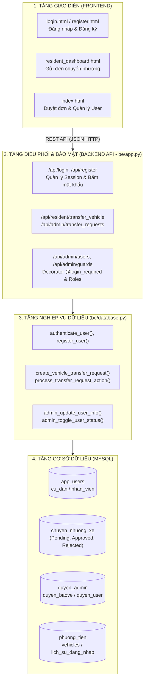
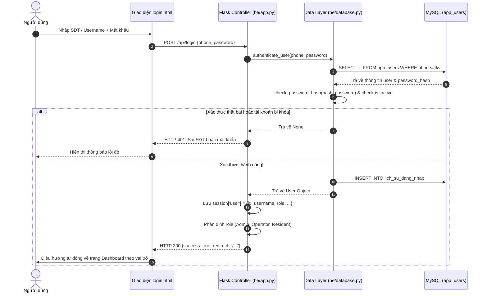
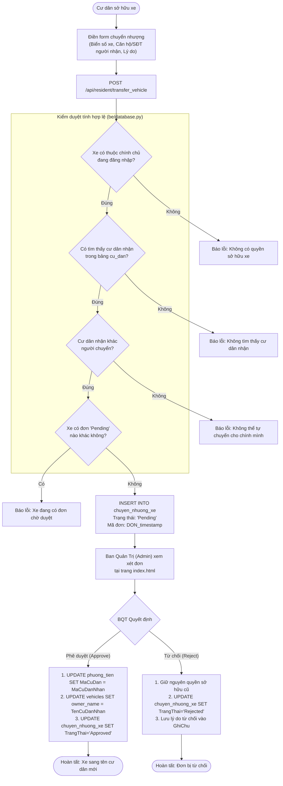

# BÁO CÁO THIẾT KẾ & MINH HỌA MÃ NGUỒN HỆ THỐNG QUẢN LÝ BÃI XE AI
**Đăng nhập / Đăng ký - Phê duyệt đơn chuyển nhượng - Quản lý & Phân quyền người dùng (RBAC)**

* **Dự án**: CNPM24CT2 - Ông Thân Quốc Trưởng
* **Thư mục dự án**: `d:\CNPM24CT2_OngThanQuocTruong\ongthanquoctruong_24CT2_cnpm`
* **File tài liệu Word hoàn chỉnh**: [`BAO_CAO_CHUC_NANG_DANGNHAP_CHUYENNHUONG_PHANQUYEN.docx`](file:///d:/CNPM24CT2_OngThanQuocTruong/ongthanquoctruong_24CT2_cnpm/BAO_CAO_CHUC_NANG_DANGNHAP_CHUYENNHUONG_PHANQUYEN.docx)

---

## MỤC LỤC
1. [Tổng quan kiến trúc phân tầng](#1-tổng-quan-kiến-trúc-phân-tầng)
2. [Chức năng 1: Đăng nhập & Đăng ký (Authentication)](#2-chức-năng-1-đăng-nhập--đăng-ký-authentication)
3. [Chức năng 2: Phê duyệt đơn chuyển nhượng xe (Vehicle Transfer)](#3-chức-năng-2-phê-duyệt-đơn-chuyển-nhượng-xe-vehicle-transfer)
4. [Chức năng 3: Quản lý & Phân quyền người dùng (RBAC)](#4-chức-năng-3-quản-lý--phân-quyền-người-dùng-rbac)
5. [Bảng đối chiếu tổng hợp mã nguồn](#5-bảng-đối-chiếu-tổng-hợp-mã-nguồn)

---

## 1. TỔNG QUAN KIẾN TRÚC PHÂN TẦNG



---

## 2. CHỨC NĂNG 1: ĐĂNG NHẬP & ĐĂNG KÝ (AUTHENTICATION)

### 2.1. Sơ đồ luồng Đăng nhập & Định tuyến theo vai trò



### 2.2. Trích đoạn mã nguồn tiêu biểu

#### A. Xác thực và lưu Session ([`be/app.py`](file:///d:/CNPM24CT2_OngThanQuocTruong/ongthanquoctruong_24CT2_cnpm/be/app.py#L1143-L1169))
```python
@app.route("/api/login", methods=["POST"])
def api_login():
    payload = request.get_json(silent=True) or {}
    phone = (payload.get("phone") or payload.get("username") or "").strip()
    password = payload.get("password") or ""
    if not phone or not password:
        return jsonify({"error": "Thiếu số điện thoại hoặc mật khẩu"}), 400

    user = database.authenticate_user(phone, password)
    if not user:
        return jsonify({"error": "Sai số điện thoại hoặc mật khẩu"}), 401

    session["user"] = {
        "id": user["id"],
        "username": user["username"],
        "full_name": user.get("full_name") or user["username"],
        "email": user.get("email") or "",
        "role": user.get("role") or "User",
    }
    
    # Định tuyến chuyên biệt theo vai trò
    if is_resident(session["user"]):
        redirect_url = get_resident_dashboard_url()      # -> /resident-dashboard
    elif is_guard(session["user"]):
        redirect_url = get_guard_dashboard_url()         # -> /operations-dashboard
    else:
        redirect_url = get_admin_dashboard_url()         # -> /operations-dashboard
        
    return jsonify({"success": True, "user": session["user"], "redirect": redirect_url})
```

#### B. Kiểm tra hash mật khẩu & Ghi vết đăng nhập ([`be/database.py`](file:///d:/CNPM24CT2_OngThanQuocTruong/ongthanquoctruong_24CT2_cnpm/be/database.py#L1144-L1175))
```python
def authenticate_user(phone, password):
    conn = get_db_connection()
    cursor = conn.cursor(dictionary=True)
    cursor.execute("""
        SELECT id, username, password_hash, full_name, email, phone, role, is_active
        FROM app_users
        WHERE phone = %s OR username = %s
        LIMIT 1
    """, (phone, phone))
    user = cursor.fetchone()
    
    if not user or not user.get('is_active'):
        return None  # Tài khoản không tồn tại hoặc đã bị khóa

    if check_password_hash(user['password_hash'], password):
        # Lưu nhật ký vào bảng lich_su_dang_nhap
        cursor.execute("SELECT MaNV FROM nhan_vien WHERE SoDienThoai = %s OR TaiKhoan = %s", (phone, phone))
        nv = cursor.fetchone()
        if nv:
            cursor.execute("INSERT INTO lich_su_dang_nhap (MaNV, DiaChiIP, TrangThai) VALUES (%s, '127.0.0.1', 'ThanhCong')", (nv['MaNV'],))
            conn.commit()
        return user
    return None
```

---

## 3. CHỨC NĂNG 2: PHÊ DUYỆT ĐƠN CHUYỂN NHƯỢNG XE (VEHICLE TRANSFER)

### 3.1. Sơ đồ quy trình Chuyển nhượng & Phê duyệt



### 3.2. Trích đoạn mã nguồn phê duyệt của Admin ([`be/database.py`](file:///d:/CNPM24CT2_OngThanQuocTruong/ongthanquoctruong_24CT2_cnpm/be/database.py#L2428-L2476))
```python
def process_transfer_request_action(request_id, action, reviewer_username, note=None):
    """Ban Quản Trị duyệt hoặc từ chối đơn chuyển nhượng xe."""
    conn = get_db_connection()
    cursor = conn.cursor(dictionary=True)
    cursor.execute("SELECT * FROM chuyen_nhuong_xe WHERE id = %s", (request_id,))
    req = cursor.fetchone()
    if not req or req["TrangThai"] != "Pending":
        return False, "Đơn không tồn tại hoặc đã được xử lý"

    if action == "approve":
        plate = req["BienSoXe"]
        recipient_cd = req["MaCuDanNhan"]
        recipient_name = req["TenCuDanNhan"]
        
        # Chuyển quyền sở hữu xe sang cư dân mới
        cursor.execute("UPDATE phuong_tien SET MaCuDan = %s WHERE BienSoXe = %s", (recipient_cd, plate))
        cursor.execute("UPDATE vehicles SET owner_name = %s WHERE plate_text = %s", (recipient_name, plate))
        
        # Cập nhật trạng thái đơn thành Approved
        cursor.execute("""
            UPDATE chuyen_nhuong_xe 
            SET TrangThai = 'Approved', NgayDuyet = NOW(), NguoiDuyet = %s, GhiChu = COALESCE(%s, GhiChu)
            WHERE id = %s
        """, (reviewer_username, note or "BQT đã duyệt chuyển nhượng", request_id))
        conn.commit()
        return True, f"Phê duyệt thành công! Xe {plate} đã được sang tên cho {recipient_name}."

    elif action == "reject":
        cursor.execute("""
            UPDATE chuyen_nhuong_xe 
            SET TrangThai = 'Rejected', NgayDuyet = NOW(), NguoiDuyet = %s, GhiChu = COALESCE(%s, 'BQT từ chối')
            WHERE id = %s
        """, (reviewer_username, note, request_id))
        conn.commit()
        return True, "Đã từ chối đơn chuyển nhượng."
```

---

## 4. CHỨC NĂNG 3: QUẢN LÝ & PHÂN QUYỀN NGƯỜI DÙNG (RBAC)

### 4.1. Ma trận phân quyền 3 cấp độ (RBAC Matrix)

| Nghiệp vụ / Quyền hạn | Admin (Quản trị viên) | Operator (Nhân viên bảo vệ) | Resident (Cư dân) |
| :--- | :---: | :---: | :---: |
| **Quản lý danh sách tài khoản, thêm/sửa/xóa** | **Toàn quyền (Full)** | Không | Không |
| **Khóa / Mở khóa tài khoản người dùng** | **Có** | Không | Không |
| **Cấp phát lại mật khẩu người dùng** | **Có** | Không | Tự đổi mật khẩu cá nhân |
| **Phê duyệt đơn chuyển nhượng phương tiện** | **Có (Duyệt / Từ chối)** | Không | Chỉ tạo đơn chuyển nhượng |
| **Giám sát Camera AI nhận diện biển số** | Xem & Kiểm thử | **Trực chính tại chốt** | Không |
| **Điều khiển đóng / mở Barrier thủ công** | Cấu hình & Can thiệp | **Thao tác vận hành** | Không |
| **Thu phí xe vãng lai & In hóa đơn** | Kiểm tra doanh thu | **Thu tiền & Ghi nhận** | Không |
| **Đăng ký vé tháng, chọn / đổi vị trí đỗ ô tô** | Hỗ trợ cấp phát | Không | **Chính chủ thao tác** |

### 4.2. Khóa tài khoản an toàn ([`be/database.py`](file:///d:/CNPM24CT2_OngThanQuocTruong/ongthanquoctruong_24CT2_cnpm/be/database.py#L1903-L1934))
Hệ thống tích hợp quy tắc an toàn cốt lõi: **Không thể khóa tài khoản Admin**:
```python
def admin_toggle_user_status(phone):
    """Khóa hoặc Mở khóa tài khoản an toàn."""
    conn = get_db_connection()
    cursor = conn.cursor(dictionary=True)
    cursor.execute("SELECT is_active, role FROM app_users WHERE phone = %s", (phone,))
    u = cursor.fetchone()
    if not u:
        return False, "Tài khoản không tồn tại"
        
    if u["role"] == "Admin":
        return False, "Không thể khóa tài khoản Quản trị viên (Admin)"
        
    new_status = not bool(u["is_active"])
    new_trang_thai = "HoatDong" if new_status else "TamKhoa"
    
    # Đồng bộ trạng thái trên cả 3 bảng
    cursor.execute("UPDATE app_users SET is_active = %s WHERE phone = %s", (new_status, phone))
    cursor.execute("UPDATE cu_dan SET TrangThai = %s WHERE SoDienThoai = %s", (new_trang_thai, phone))
    cursor.execute("UPDATE nhan_vien SET TrangThai = %s WHERE SoDienThoai = %s", (new_trang_thai, phone))
    conn.commit()
    return True, "Đã mở khóa tài khoản" if new_status else "Đã tạm khóa tài khoản"
```

---

## 5. BẢNG ĐỐI CHIẾU TỔNG HỢP MÃ NGUỒN

| Nhóm chức năng | Giao diện Web (FE) | Tầng API Điều phối (BE) | Tầng Xử lý CSDL (DAL) | Bảng CSDL liên quan |
| :--- | :--- | :--- | :--- | :--- |
| **Đăng nhập / Đăng ký** | [`login.html`](file:///d:/CNPM24CT2_OngThanQuocTruong/ongthanquoctruong_24CT2_cnpm/fe/templates/login.html), [`register.html`](file:///d:/CNPM24CT2_OngThanQuocTruong/ongthanquoctruong_24CT2_cnpm/fe/templates/register.html) | [`be/app.py`](file:///d:/CNPM24CT2_OngThanQuocTruong/ongthanquoctruong_24CT2_cnpm/be/app.py) (`/api/login`, `/api/register`) | [`be/database.py`](file:///d:/CNPM24CT2_OngThanQuocTruong/ongthanquoctruong_24CT2_cnpm/be/database.py) (`authenticate_user`, `register_user`) | `app_users`, `cu_dan`, `lich_su_dang_nhap` |
| **Phê duyệt chuyển nhượng** | [`resident_dashboard.html`](file:///d:/CNPM24CT2_OngThanQuocTruong/ongthanquoctruong_24CT2_cnpm/fe/templates/resident_dashboard.html), [`index.html`](file:///d:/CNPM24CT2_OngThanQuocTruong/ongthanquoctruong_24CT2_cnpm/fe/templates/index.html) | [`be/app.py`](file:///d:/CNPM24CT2_OngThanQuocTruong/ongthanquoctruong_24CT2_cnpm/be/app.py) (`/api/resident/transfer_vehicle`, `/api/admin/transfer_requests/...`) | [`be/database.py`](file:///d:/CNPM24CT2_OngThanQuocTruong/ongthanquoctruong_24CT2_cnpm/be/database.py) (`create_vehicle_transfer_request`, `process_transfer_request_action`) | `chuyen_nhuong_xe`, `phuong_tien`, `vehicles` |
| **Quản lý & Phân quyền** | [`index.html`](file:///d:/CNPM24CT2_OngThanQuocTruong/ongthanquoctruong_24CT2_cnpm/fe/templates/index.html) (`users-page`) | [`be/app.py`](file:///d:/CNPM24CT2_OngThanQuocTruong/ongthanquoctruong_24CT2_cnpm/be/app.py) (`/api/admin/users/...`, `@login_required`) | [`be/database.py`](file:///d:/CNPM24CT2_OngThanQuocTruong/ongthanquoctruong_24CT2_cnpm/be/database.py) (`get_all_users_list`, `admin_update_user_info`) | `quyen_admin`, `quyen_baove`, `quyen_user` |

