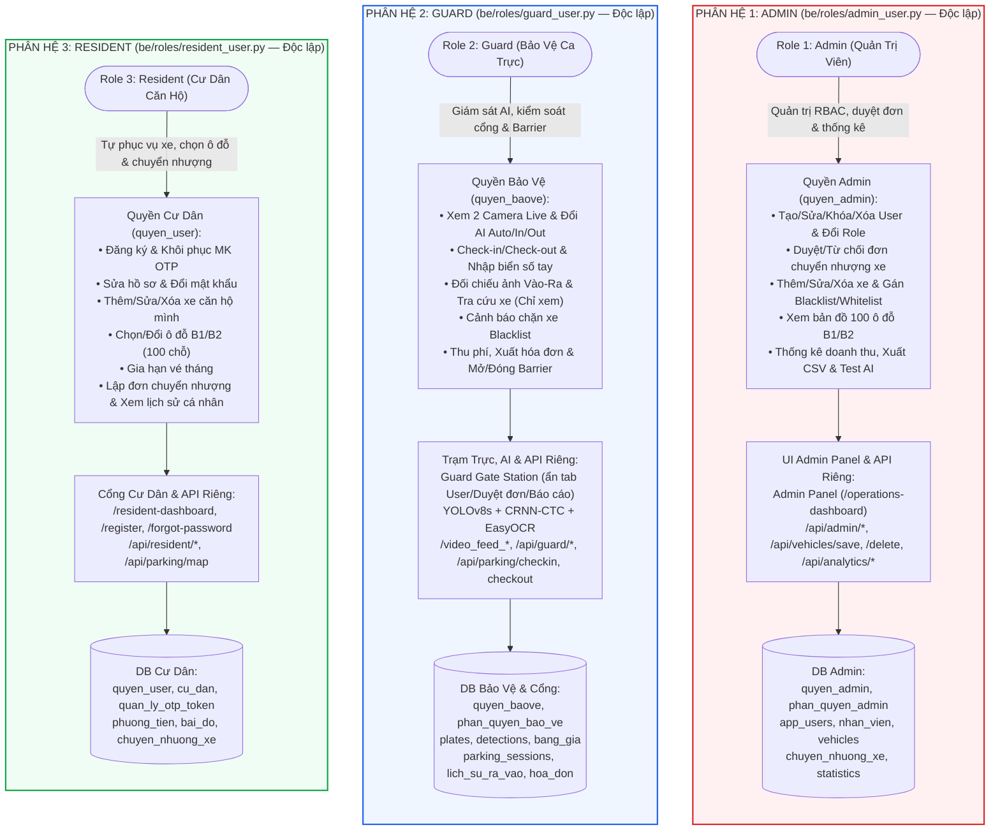

# Hệ Thống Quản Lý Bãi Đỗ Xe Thông Minh Ứng Dụng AI Nhận Diện Biển Số Xe (Smart Parking AI)

- **Đề tài**: Hệ thống Nhận diện Biển số xe & Quản lý Bãi đỗ xe Thông minh ứng dụng AI
- **Môn học**: Công nghệ phần mềm (CNPM24) — **Lớp**: `24CT2`
- **Sinh viên thực hiện**: Ông Thân Quốc Trường
- **Đơn vị**: Khoa Công nghệ thông tin — Trường Đại học Kiến trúc Đà Nẵng (DAU)

> Xem tài liệu tổng quan cấp repository tại [`../README.md`](../README.md). Hệ thống chính sử dụng **Python Flask (`be/`) + AI (`YOLOv8s + CRNN-CTC + EasyOCR`) + CSDL duy nhất MySQL (`be/database.py` & `be/sql/httt_quan_ly_bai_xe_ai.sql`)**; không dùng Mock DB trong kiến trúc đề tài.
> Mỗi vai trò (`Admin`, `Guard`, `Resident`) nằm trên một phân hệ độc lập, tuyệt đối không nối mũi tên `"uses"` / `"uses guard view"` hay gộp chung `Resident and admin services` / `Operations dashboard [index.html]`.

---

## 🏛️ Kiến Trúc 3 Quyền Tách Biệt Độc Lập (3 Isolated Roles — Không Dính Dáng Nhau)



---

## 👥 Chi Tiết 3 Vai Trò Trong Đề Tài

1. **Role 1 — Quản trị viên (`Admin` | `be/roles/admin_user.py` -> Admin Panel)**:
   - Quản lý tài khoản & phân quyền (`app_users`, `nhan_vien`, `cu_dan`, `quyen_admin`, `phan_quyen_admin`): tạo Bảo vệ (`/api/admin/guards/create`), tạo Cư dân (`/api/admin/residents/create`), sửa thông tin & đổi vai trò (`/api/admin/users/update`), khóa/mở tài khoản (`/api/admin/users/toggle_status`), đặt lại mật khẩu (`/api/admin/users/reset_password`), xóa người dùng.
   - Phê duyệt đơn chuyển nhượng xe (`/api/admin/transfer_requests`, `/api/admin/transfer_requests/<id>/action`, `/update_doc` -> `chuyen_nhuong_xe`).
   - Quản lý danh mục phương tiện & phân nhóm `Normal / Whitelist / Blacklist` (`/api/vehicles`, `/api/vehicles/save`, `/api/vehicles/delete/<plate>` -> `vehicles`, `plates`).
   - Quản lý bản đồ 100 ô đỗ 2 tầng hầm (`Ham_B1`, `Ham_B2`: `/api/parking/map` -> `bai_do`).
   - Xem thống kê KPI, doanh thu, giờ cao điểm, xuất CSV & test AI ảnh tĩnh (`/get_dashboard_summary`, `/api/analytics/revenue`, `/api/analytics/peak-hours`, `/api/report_export`, `/api/recognize_image`).

2. **Role 2 — Nhân viên Bảo vệ (`Guard` / `Operator` | `be/roles/guard_user.py` -> Guard Gate Station)**:
   - Giám sát Camera Live Stream (`/video_feed_webcam`, `/video_feed_phone`) & chuyển đổi chế độ camera (`/api/guard/camera_mode`, `/api/guard/latest_event`).
   - Kiểm soát xe vào/ra, đối chiếu ảnh chụp lúc vào và lúc ra (`/api/guard/verification/<plate>`, `/api/guard/manual_entry`, `/api/parking/checkin`, `/api/parking/checkout/<id>`).
   - Tiếp nhận cảnh báo đỏ xe `Blacklist`, từ chối mở cổng.
   - Tra cứu cước phí gửi xe, thu tiền & kích hoạt mở/đóng Barrier (`/api/guard/collect_fee`, `/api/guard/barrier/trigger` -> `bang_gia`, `hoa_don`, `lich_su_ra_vao`, `quyen_baove`, `phan_quyen_bao_ve`).

3. **Role 3 — Cư dân (`Resident` | `be/roles/resident_user.py` -> `/resident-dashboard`)**:
   - Đăng ký tài khoản cư dân (`/register`, `/api/register`), Đăng nhập (`/login`, `/api/login`), Quên & Đặt lại mật khẩu qua OTP (`/forgot-password`, `/reset-password` -> `quan_ly_otp_token`).
   - Cập nhật hồ sơ & đổi mật khẩu (`/api/resident/profile`, `/api/resident/update_profile`, `/api/resident/change_password`).
   - Quản lý xe căn hộ (`/api/resident/vehicles`, `/api/resident/add_vehicle`, `PUT/DELETE /api/resident/vehicles/<plate>` -> `phuong_tien`, `vehicles`).
   - Xem bản đồ 100 ô đỗ `Ham_B1` & `Ham_B2`, chọn / đổi vị trí đỗ (`/api/parking/map`, `/api/resident/change_slot` -> `bai_do`).
   - Gia hạn vé tháng, lập/theo dõi đơn chuyển nhượng xe & xem lịch sử ra/vào cá nhân (`/api/resident/renew_ticket`, `/api/resident/transfer_vehicle`, `/api/resident/transfer_requests`, `/api/resident/history`).

---

## 🏗️ Cấu Trúc Dự Án

```text
ongthanquoctruong_24CT2_cnpm/
├── api/                              # Bản mô phỏng xem thử UI trên Vercel (không phải CSDL đề tài)
├── public/                           # Giao diện tĩnh xem thử (bản chính thức dùng fe/templates/)
├── fe/                               # Frontend Jinja2 Templates & Static assets (Local Flask)
├── be/                               # Backend Flask + YOLOv8 + CRNN/EasyOCR + MySQL + roles/ + sql/ + scripts/
├── tests/                            # Bộ kiểm thử tự động (test_full_features.py, test_user_management.py, ...)
├── docs/                             # Tuần Tự/, LUONGXULY/, PERT/, Wireframe/, Word báo cáo/, drawio/
├── doc_images/                       # Ảnh sơ đồ & UI demo dùng cho báo cáo
├── schema.dbml                       # Lược đồ quan hệ DBML phục vụ GitDiagram
├── vercel.json                       # Cấu hình định tuyến Vercel
├── package.json                      # Thông tin package phục vụ Vercel/static serve
├── requirements.txt                  # Thư viện Python cho Backend & AI
└── .env.example                      # Mẫu biến môi trường MySQL & SECRET_KEY
```

---

## 🚀 Hướng Dẫn Cài Đặt & Khởi Chạy Local

1. **Kích hoạt môi trường ảo:**
   ```powershell
   .venv\Scripts\activate
   ```
2. **Cài đặt các thư viện cần thiết:**
   ```bash
   pip install -r requirements.txt
   ```
3. **Cấu hình MySQL (tạo `.env` từ `.env.example`):**
   ```env
   MYSQL_HOST=localhost
   MYSQL_USER=root
   MYSQL_PASSWORD=your_mysql_password
   MYSQL_DATABASE=HTTT_QuanLyBaiXe_AI
   MYSQL_PORT=3306
   APP_SECRET_KEY=dev-secret-change-me
   ```
   Khởi tạo bảng và dữ liệu 100 chỗ đỗ:
   ```powershell
   python be/setup_bai_do.py
   ```
4. **Khởi chạy Server Flask:**
   ```powershell
   python be/app.py
   ```
   Truy cập: **http://127.0.0.1:5000**

---

## 🧪 Chạy Kiểm Thử (Run Tests)

```powershell
python -m unittest discover -s tests -p "test_*.py"
```
